# Joomla User Tools

**Español** · [English](README.en.md)

Herramientas para administrar cuentas en **Joomla 6**: comparar una lista de usuarios vigentes, crear cuentas nuevas, revisar la inactividad y programar bloqueos con informes.

| Herramienta | Qué hace |
|---|---|
| Comparar una lista | Propone bloquear las cuentas ausentes de la lista completa, salvo las protegidas, y permite crear los usuarios nuevos que selecciones. |
| Revisar usuarios inactivos | Busca cuentas inactivas para que selecciones cuáles bloquear. |
| Anonimizar cuentas | Sustituye los datos personales de las cuentas de una lista, de todas las inactivas o de un grupo, sin eliminarlas. Permanente, con revisión y número escrito. Disponible desde 2026.10.17. |
| Eliminar usuarios inactivos | Permite seleccionar y borrar definitivamente cuentas inactivas. Por defecto lista solo las ya bloqueadas. Disponible desde 2026.10.5. |
| Tarea programada | Bloquea cuentas por inactividad; empieza en modo simulación y genera informes. |
| Resumen en el panel | Muestra en el panel de Usuarios las cuentas pendientes, el estado de las tareas y avisos. Disponible desde 2026.10.6. |
| Grupos de usuarios en el sitio | Módulo del sitio que lista los grupos de un usuario o los miembros de un grupo. Solo lee. Disponible desde 2026.10.9. |
| Añadir cuentas a grupos | Añade cuentas existentes a grupos por ID o ruta completa, sin quitar grupos ya asignados; exige revisión y confirmación. |
| Quitar de grupos | Elige una cuenta, desmarca los grupos de los que debe salir y, si quieres, quítala también de todos sus subgrupos. Con revisión previa y confirmación. Disponible desde 2026.10.9. |
| Mover grupos | Cambia de una vez el grupo padre de varios grupos, con sus subgrupos, tras revisar qué niveles ganan o pierden sus miembros. Rechaza los movimientos que cambiarían el acceso a la administración. Solo superusuarios. Disponible desde 2026.10.16. |
| Grupos y niveles de acceso | Tabla de solo lectura con los niveles de acceso que tiene cada grupo, asignados o heredados. Disponible desde 2026.10.9. |
| Contenido por nivel de acceso | Cuántos artículos, categorías, menús, módulos, campos y demás elementos usan cada nivel, con enlace a cada listado filtrado. Solo lee. Disponible desde 2026.10.12. |
| Contenido por antigüedad | Tabla por años con cuántos artículos se modificaron por última vez en cada uno, filtrable por nivel de acceso; cada cifra abre la lista de esos artículos con enlace para editarlos. Solo lee. Disponible desde 2026.10.15. |
| Diagnóstico de accesos | Señala cuentas con acceso a la administración sin actividad, si queda un solo superusuario, niveles de acceso que no tiene nadie, contenido con niveles que no existen y grupos sin miembros. Explica cada aviso y solo lee. Disponible desde 2026.10.15. |

**Bloquear conserva la cuenta y sus datos; eliminar la borra y no se puede deshacer.** Solo la herramienta manual de eliminación borra cuentas. Ninguna herramienta reactiva cuentas automáticamente.

La portada agrupa las herramientas en cuatro secciones, con su explicación siempre visible: **Revisar cuentas** (comparar una lista y revisar inactivos), **Grupos y niveles de acceso** (quitar de grupos, las pantallas de consulta de grupos, niveles y contenido, y el diagnóstico de accesos), **Automatización y seguimiento** (la tarea programada, con el estado de su plugin, y sus resultados) y, al final y aparte, **Eliminar cuentas**, la única marcada como «Permanente». Cada persona ve solo las herramientas que tiene permitidas, y las secciones sin ninguna desaparecen. Desde cualquier otra pantalla, el botón «Inicio de User Tools» de la barra de Joomla vuelve a la portada.

**Requisitos:** Joomla 6 y PHP 8.3 o posterior. Compatible con MySQL/MariaDB y PostgreSQL.  
**Descarga:** [última release](https://github.com/Danieldiazi/joomla-user-tools/releases/latest), paquete `pkg_usertools-VERSIÓN.zip`.  
**Licencia:** [GPL-2.0-or-later](LICENSE).

## Índice

- [Instalación y actualizaciones](#instalación-y-actualizaciones)
- [Comparar una lista de usuarios](#comparar-una-lista-de-usuarios)
- [Revisar usuarios inactivos](#revisar-usuarios-inactivos)
- [Eliminar usuarios inactivos](#eliminar-usuarios-inactivos)
- [Anonimizar cuentas](#anonimizar-cuentas)
- [Tarea programada e informes](#tarea-programada-por-inactividad)
- [Resumen en el panel de Usuarios](#resumen-en-el-panel-de-usuarios)
- [Módulo de grupos de usuarios en el sitio](#módulo-de-grupos-de-usuarios-en-el-sitio)
- [Añadir cuentas a grupos en bloque](#añadir-cuentas-a-grupos-en-bloque)
- [Quitar de grupos](#quitar-de-grupos)
- [Mover grupos](#mover-grupos)
- [Grupos y niveles de acceso](#grupos-y-niveles-de-acceso)
- [Contenido por nivel de acceso](#contenido-por-nivel-de-acceso)
- [Contenido por antigüedad](#contenido-por-antigüedad)
- [Diagnóstico de accesos](#diagnóstico-de-accesos)
- [Seguridad](#seguridad)
- [Opciones](#opciones)
- [Capturas de las herramientas](#capturas-de-las-herramientas)
- [Desarrollo](#desarrollo)
- [Mapa de arquitectura](docs/arquitectura.md)
- [Construcción y publicación](#construcción-y-publicación)

¿Dudas concretas? Consulta las [preguntas frecuentes](FAQ.md). Si vas a contribuir, o a trabajar con un agente de código, lee [AGENTS.md](AGENTS.md).

El módulo **User Tools** del panel de Usuarios ofrece accesos directos a cada herramienta según los permisos de quien consulta el panel, además de los indicadores y del enlace general a User Tools.

## Instalación y actualizaciones

Descarga de la [última release](https://github.com/Danieldiazi/joomla-user-tools/releases/latest) el fichero **pkg_usertools-VERSIÓN.zip** e instálalo desde Sistema → Instalar → Extensiones. El paquete instala el componente, el plugin de tareas, el módulo de administración «User Tools» y el módulo del sitio «User Tools - Grupos de usuarios». En una instalación nueva habilita el plugin «Tarea - User Tools», y la primera vez que se instala el módulo lo publica en el panel de Usuarios. Las tareas que crees empiezan siempre en modo simulación.

A partir de la 2026.10.3, Joomla avisa de las versiones nuevas en Sistema → Actualizar → Extensiones, como con cualquier otra extensión: el paquete declara un servidor de actualizaciones que apunta a la última release de GitHub. Para actualizar, instala el paquete nuevo encima; no desinstales el componente. Al actualizar desde versiones anteriores, las exclusiones guardadas se migran solas.

El instalador comprueba las versiones mínimas, registra la extensión en el registro de acciones de usuarios y crea la plantilla de correo «User Tools: cuenta creada». Al desinstalar avisa de que los informes de tareas se conservan en la carpeta de registros.

## Comparar una lista de usuarios

**Ejemplo:** en Joomla existen las cuentas `ana`, `luis` y `marta`. Si pegas una lista con `ana` y `marta`, se propone bloquear a `luis`, salvo que esté protegido o ya bloqueado. Si añades `pedro` y no existe, podrás seleccionarlo para crear su cuenta; no se crea automáticamente.

1. Abre Componentes → User Tools → «Comparar lista».
2. Pega la lista **completa** de nombres de usuario vigentes, uno por línea, y revisa las exclusiones.
3. En la revisión verás las cuentas que se bloquearán, con nombre, correo, último acceso y grupos, y un filtro si la lista es larga. También verás los nombres que no existen en Joomla, para darlos de alta si quieres.
4. Confirma. El resultado enlaza cada cuenta con el gestor de usuarios. Para deshacer un bloqueo, abre la cuenta y cambia su estado a Habilitado.

Desde la 2026.10.11, los cambios se aplican **por tandas** de unos segundos, para que ninguna petición choque con el límite de tiempo de PHP o del servidor web (antes, dar de alta cientos de cuentas de golpe podía acabar en un error 500 a mitad). Si caben en una tanda, el resultado aparece directamente. Si no, una barra de progreso muestra cuántas cuentas lleva y la página pide la siguiente tanda sola. Cada cuenta se vuelve a comprobar, se cambia y se anota en el registro de acciones por separado, así que un corte no pierde nada de lo hecho. Si cierras la pestaña o se corta la conexión, «Comparar lista» avisa de la operación a medias y ofrece **continuar** o **descartar** lo pendiente; mientras tanto no se puede aplicar otra comparación. En el modo de contraseña temporal, cada contraseña aparece en la pantalla de progreso al crearse su cuenta (con un botón «Copiar todo») y no se guarda en ningún sitio: cópialas antes de salir.

Los nombres se comparan sin distinguir mayúsculas y minúsculas: OTRO y otro son la misma cuenta. Una lista vacía no se admite. Si **ningún nombre coincide** con una cuenta existente, la revisión lo avisa en rojo arriba del todo, porque se propondría bloquear todas las cuentas no protegidas.

Una lista incompleta puede producir bloqueos incorrectos: revisa siempre la previsualización.

### Altas de cuentas nuevas

Las cuentas nuevas se crean en el grupo **Registrados** (se comprueba que exista y no tenga acceso a la administración), con un correo distinto para cada una. Hay dos modos, que se eligen en cada operación:

- **Enviar un enlace para elegir la contraseña** (por defecto). La cuenta se crea con una contraseña aleatoria que nadie ve, y la persona recibe un correo con un enlace a la página estándar de Joomla para elegir la suya. El texto del correo se edita en Sistema → Plantillas de correo → «User Tools: cuenta creada». Requiere que el envío de correo esté activado en la configuración global.
- **Mostrar una contraseña temporal.** Se genera una contraseña aleatoria que cumple la política de contraseñas de Joomla (longitud y número mínimo de dígitos, símbolos, mayúsculas y minúsculas) y se muestra **una sola vez**, en la misma respuesta que crea la cuenta. No se guarda en la sesión, en la base de datos ni en los registros. La persona debe cambiarla en su primer acceso.

Si la lista trae muchos nombres nuevos, dos ayudas de la revisión ahorran trabajo (desde la 2026.10.11):

- La casilla de la cabecera **Añadir** marca o desmarca todas las cuentas nuevas a la vez.
- **Generar el correo a partir del nombre de usuario**: marca la casilla y escribe el dominio (por ejemplo `correo.com`, con o sin `@`). Cada correo vacío se rellena como `usuario@correo.com`. Los correos escritos a mano no se cambian; si cambias el dominio se actualizan los generados, y si desmarcas la casilla se borran. Los nombres que no sirven como correo (con espacios o tildes, por ejemplo) se quedan vacíos y se avisa de cuántos son, para que escribas su correo. Revisa los correos antes de aplicar: con el modo de enlace, el acceso se envía a ellos.

La herramienta no envía el correo de bienvenida del plugin de usuarios de Joomla.

## Revisar usuarios inactivos

En la portada, «Revisar cuentas inactivas». Elige el plazo en días, si se incluyen quienes nunca accedieron (con el plazo contado desde su registro) y las exclusiones. Busca, marca solo las cuentas que quieres suspender y confirma. No hay cuentas marcadas de entrada, y «Seleccionar todos» solo afecta a las filas visibles con el filtro. Se omiten las cuentas ya bloqueadas y las que tienen una sesión reciente.

## Eliminar usuarios inactivos

En la portada, «Revisar cuentas para eliminar». Es la única herramienta que **borra** cuentas, y el borrado no se puede deshacer; para impedir el acceso sin borrar, usa la revisión de inactivos.

1. Elige el plazo en días (730 por defecto), si se incluyen quienes nunca accedieron y qué cuentas se listan: **solo bloqueadas** (opción por defecto desde 2026.10.6; las que ya bloqueó la revisión de inactivos o la tarea programada), **activas y bloqueadas** o **solo activas**.
2. Configura sus exclusiones, que son propias e iguales que en el resto de herramientas: excluir administradores, nombres de usuario y grupos (con sus subgrupos). Los superusuarios y tu propia cuenta nunca se listan.
3. En la revisión verás nombre, correo, estado, último acceso, fecha de registro y grupos de cada cuenta, con un filtro si la lista es larga. Ninguna cuenta viene marcada.
4. Marca las que quieras eliminar, confirma la casilla y **escribe el número de cuentas**. En esta herramienta se pide siempre, aunque sea una.

Antes de borrar se vuelve a comprobar cada cuenta. Las que hayan cambiado después de la revisión (porque accedieron, pasaron a estar excluidas o tienen una sesión reciente) se omiten y no se sustituyen por otras.

El plazo se cuenta desde el último acceso o, si nunca accedió y se incluye esa opción, desde la fecha de registro. **730 días es una duración fija, no dos años de calendario.**

La cuenta se elimina con la API de usuarios de Joomla, igual que desde el gestor de usuarios. Se borran sus grupos, su perfil, sus sesiones y sus mensajes privados, y otras extensiones pueden limpiar sus propios datos. Los artículos y demás contenidos que creó se conservan, como al borrar desde Joomla.

Cada eliminación queda en el **registro de acciones de usuarios** con el ID, el nombre de usuario, el nombre y quién la hizo («… eliminó con User Tools la cuenta inactiva …»). Joomla añade además su propia entrada de borrado de usuario.

## Añadir cuentas a grupos en bloque

Desde **User Tools → Añadir cuentas a grupos** se pueden añadir usuarios existentes a grupos sin eliminar sus pertenencias actuales. Introduce una lista de usuarios o correos y un grupo de destino, o pares `usuario;#ID` en líneas independientes. Los grupos se identifican por `#ID` o **ruta completa** (por ejemplo `Public/Registered`); los títulos aislados o rutas duplicadas se rechazan. La revisión muestra qué se añadiría, qué ya existe y qué se excluye. Solo se pueden asignar grupos sin acceso a administración y no se modifican administradores, superusuarios ni la cuenta del operador. Debes confirmar y escribir el número de cuentas. El guardado usa la API de Joomla, cierra sesiones, registra cada asignación y continúa por tandas para listas grandes.

## Anonimizar cuentas

Desde la 2026.10.17, **Anonimizar cuentas** sustituye los datos personales de varias cuentas a la vez sin eliminarlas. Joomla solo lo hace una a una, desde una solicitud de eliminación en Usuarios → Privacidad que la persona tiene que confirmar por correo. Es **permanente**: no se puede deshacer.

1. **Elegir cuentas**, de una de estas tres formas:
   - **Una lista**: nombres de usuario o correos, uno por línea, sin distinguir mayúsculas. Los que no corresponden a ninguna cuenta se indican en la revisión.
   - **Todas las cuentas inactivas**: las que, bloqueadas o no, no han entrado en el plazo indicado (730 días por defecto), con la opción de incluir a quien nunca entró.
   - **Las cuentas de un grupo**, con la casilla «y sus subgrupos» para incluir también las de los grupos que cuelgan de él.

   Tiene sus propias exclusiones (administradores, nombres y grupos), como el resto de herramientas.
2. **Seleccionar y confirmar**: la lista de cuentas encontradas, ninguna marcada. Las que siguen activas se señalan como «Activa», porque dejarán de poder entrar. Debajo aparecen las que no se ofrecen y por qué: protegidas, ya anonimizadas o nombres sin cuenta. Hay que marcar la confirmación y **escribir siempre el número de cuentas**.
3. **Resultado**: las cuentas anonimizadas, con su ID (que abre la cuenta en Usuarios), su nombre de usuario anterior (que solo se ve en esa pantalla) y su nombre y usuario nuevos, las omitidas y los errores. Las tandas grandes se procesan en varias peticiones con el botón «Continuar la anonimización».

Qué se hace con cada cuenta:

- Se piden permiso y se ejecutan los **plugins de privacidad de Joomla**, como en una solicitud de eliminación completada. El plugin «Privacidad - Cuentas de usuario» cambia el nombre a «User ID» y el número, el usuario a un valor aleatorio y el correo a `UserID…removed@email.invalid`, bloquea la cuenta y cierra sus sesiones. Los plugins de privacidad de otras extensiones limpian sus propios datos. Si ese plugin está deshabilitado, la herramienta lo avisa y no busca cuentas.
- User Tools borra además lo que ese plugin deja: los **campos del perfil**, las **notas de usuario** y los **valores de campos personalizados** de la cuenta.
- La cuenta **no se elimina**: conserva su ID y sus grupos, así que los artículos y demás contenidos siguen apuntando a ella, ya sin datos personales.
- No se crea ninguna solicitud en Privacidad, porque nadie la pidió. Cada anonimización queda en el **registro de acciones de usuarios** solo con el ID de la cuenta y quién la hizo. Las entradas anteriores del registro no se modifican.
- Cada cuenta se vuelve a comprobar justo antes de anonimizarla. Si entró, cambió de grupos o dejó de cumplir los criterios después de la revisión, se omite.

Requiere el permiso propio *Anonimizar cuentas*. Superusuarios, tu propia cuenta y, para quien no es superusuario, las cuentas con acceso a la administración nunca se ofrecen.

Si falla el borrado del perfil, las notas o los campos, la cuenta **ya está anonimizada** y queda registrada como tal, pero el resultado indica **«Limpieza incompleta»**. Para recuperar la limpieza, vuelve a «Anonimizar cuentas», selecciona **«Solo repetir la limpieza de cuentas ya anonimizadas»**, indica el usuario anonimizado (o filtra por grupo/inactividad), revisa y confirma. Este modo **solo** admite cuentas ya anonimizadas y bloqueadas; no anonimiza cuentas nuevas, y cada limpieza recuperada se anota por separado en el registro de acciones.

## Tarea programada por inactividad

1. Comprueba que el plugin «Tarea - User Tools» está habilitado; la portada indica su estado.
2. Ve a Sistema → Tareas programadas → Nueva y elige **User Tools: bloquear usuarios inactivos**.
3. Configura el plazo (365 días por defecto), sus exclusiones y el límite de seguridad.
4. La **simulación está activada por defecto**. Ejecútala y revisa el informe en Componentes → User Tools → Resultados de tareas.
5. Cuando los candidatos sean correctos, desactiva la simulación y programa la frecuencia; con una vez al día suele bastar.

El último acceso debe ser **estrictamente anterior** a la fecha límite, calculada en UTC. El plazo admite de 1 a 36.500 días. La tarea actúa sin identidad de usuario: no importa qué visitante dispare el programador de Joomla.

### Límite de seguridad contra bloqueos masivos

Si una ejecución fuera a bloquear **más del porcentaje configurado de las cuentas activas** (20 % por defecto), no bloquea ninguna. El informe la muestra como «Detenida por seguridad» y la tarea termina con error, de modo que Joomla envía su aviso habitual de tarea fallida. Así, una configuración equivocada o unas fechas de acceso erróneas no pueden dejar a casi todos los usuarios sin acceso.

El límite solo se comprueba a partir de un número mínimo de candidatos (10 por defecto), para que en webs pequeñas unas pocas cuentas no detengan la tarea. En simulación solo se avisa en el informe.

Ejemplo con los valores por defecto: en una web con 1.000 cuentas activas, la tarea se detiene si encuentra más de 200 candidatos. En una con 30 cuentas activas, 7 candidatos (23 %) no la detienen porque no llegan al mínimo de 10. Con 0 % o 100 % el límite se desactiva.

Para ejecutar las tareas aunque no haya visitas, configura el cron del alojamiento según la [guía oficial de Joomla](https://guide.joomla.org/user-guide/scheduled-tasks/how-to-choose-a-scheduler).

### Resultados de tareas

Componentes → User Tools → Resultados de tareas muestra cada ejecución con fecha UTC, tarea, modo, estado y cantidades, con filtros por tarea, modo y estado. El detalle lista las cuentas bloqueadas, simuladas, protegidas (con su motivo) o con error, y resume las omitidas por motivo. Cada informe se puede **exportar a CSV** (UTF-8, separado por punto y coma, protegido contra fórmulas al abrirlo en una hoja de cálculo).

Los informes se guardan en la subcarpeta usertools-reports de la carpeta de registros de Joomla, con una cabecera PHP que impide leerlos desde la web. Se borran al terminar cada ejecución según los días configurados en Opciones.

## Resumen en el panel de Usuarios

Desde la 2026.10.6, el panel **Usuarios** de la administración (el icono de panel junto a «Usuarios» en el menú lateral) muestra un módulo «User Tools» con:

- **Cuentas inactivas sin bloquear**, con el plazo y las exclusiones de «Revisar usuarios inactivos». La cifra enlaza con esa herramienta.
- **Cuentas bloqueadas pendientes de eliminar**: las que ofrecería «Eliminar usuarios inactivos» con «Solo bloqueadas», su plazo y sus exclusiones. La cifra abre la herramienta con esa opción ya elegida.
- **Tareas programadas de User Tools**, con modo (simulación o real), última ejecución, resultado (enlazado con su informe) y próxima ejecución.
- **Avisos**: plugin de tareas deshabilitado o no instalado, ninguna tarea habilitada, una tarea detenida por el límite de seguridad, fallida o con un informe sin finalizar desde hace más de una hora, una tarea que sigue en simulación más de 14 días después de crearla y, desde la 2026.10.15, las comprobaciones del [diagnóstico de accesos](#diagnóstico-de-accesos) que conviene revisar, solo para quien puede verlo.

Desde la 2026.10.14, las cifras se presentan como «Inactivas para revisar» y «Bloqueadas para revisar»: son cuentas candidatas, no acciones automáticas, y cada tarjeta enlaza con su revisión. Cada tarea muestra su modo, el resultado de la última ejecución con enlace al informe y las fechas con su etiqueta; si no tiene próxima ejecución, se explica por qué. Cuando alguna tarea está en simulación, una nota recuerda que la simulación no modifica cuentas. Al pie aparecen la fecha de actualización y cómo funciona la caché.

Las cifras usan exactamente las mismas reglas que las herramientas, así que coinciden con lo que verás al abrirlas. Se calculan como mucho cada **10 minutos** y se recalculan en cuanto una herramienta o una tarea cambia cuentas, o se guardan las Opciones.

El módulo respeta los permisos: solo lo ve quien puede acceder a User Tools, las cifras solo aparecen a quien tiene permiso de revisar o eliminar inactivos, y las tareas solo a quien puede ver sus resultados. Se configura como cualquier módulo de administración (Contenido → Módulos del sitio de administración, «User Tools»): puedes moverlo a otro panel, cambiarle el título o despublicarlo. Las actualizaciones no vuelven a colocarlo si lo has movido o despublicado.

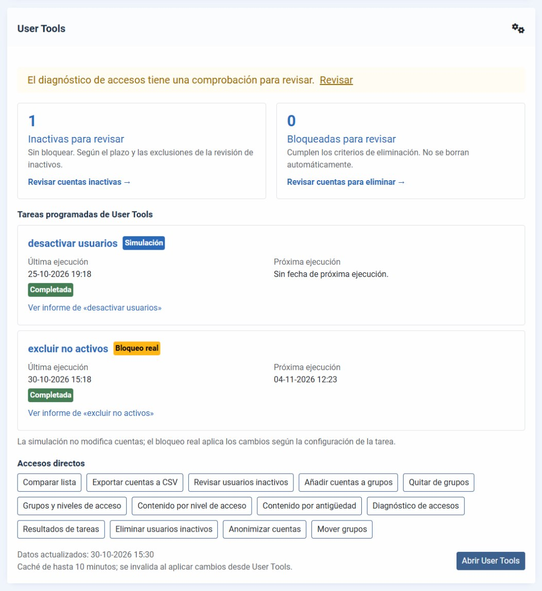

## Módulo de grupos de usuarios en el sitio

Desde la 2026.10.9, el paquete incluye el módulo del sitio **«User Tools - Grupos de usuarios»**. Joomla no trae ningún módulo que muestre en el sitio a qué grupos pertenece alguien ni quién está en un grupo; este lo hace en dos modos. El instalador no lo publica: créalo en Contenido → Módulos del sitio → Nuevo.

**Grupos de un usuario.** Muestra los grupos del *visitante identificado* (cada persona ve los suyos; a los invitados no se les muestra nada) o de *un usuario concreto* elegido en la configuración. Opciones:

- *Incluir grupos heredados*: añade los grupos padre de los que hereda permisos, atenuados. Por ejemplo, un miembro de «Autor» verá también «Registrado».
- *Grupos que no se muestran*: grupos que nunca aparecen, como «Público».

**Miembros de un grupo.** Lista las cuentas activas de un grupo, en orden alfabético. Opciones:

- *Incluir subgrupos*: lista también a quien está en los grupos que cuelgan del elegido.
- *Mostrar cada miembro como*: nombre, nombre de usuario o los dos.
- *Ocultar cuentas con acceso a la administración* (activada por defecto): no lista a nadie que esté en un grupo con acceso a la administración o de superusuarios, para no exponer en el sitio las cuentas más sensibles.
- *Máximo de miembros* (50 por defecto, hasta 1000) y *Mostrar el total de miembros*. Si hay más miembros que el máximo, el módulo indica cuántos faltan.

En los dos modos, *Mostrar si la lista está vacía* decide si el módulo se ve cuando no hay nada que listar.

**Privacidad.** El módulo nunca muestra correos electrónicos ni cuentas bloqueadas, y no cambia cuentas ni grupos. Aun así, los nombres de los miembros son datos personales: usa el campo **Acceso** del módulo para decidir quién lo ve (por ejemplo, *Registrado*) en lugar de dejarlo en *Público*. Para los invitados, la lista de miembros sigue la caché de módulos de Joomla; a los usuarios identificados se les calcula siempre al momento.

La lista se obtiene con un número fijo de consultas, sea cual sea el tamaño del grupo. Las cuentas con acceso a la administración se deciden por grupo, con los permisos globales de Joomla, como en el resto de User Tools.

## Quitar de grupos

Desde la 2026.10.9, **Quitar de grupos** saca una cuenta de los grupos que elijas y, si lo pides, también de todos los grupos que cuelgan de ellos: hijos, nietos y siguientes. El lote de Joomla («Quitar del grupo» en Usuarios) solo quita del grupo exacto que eliges y no enseña antes los grupos de la cuenta.

1. **Cuenta**: escribe parte del usuario, el nombre o el correo y elige la cuenta en la lista que aparece mientras escribes. También vale el usuario o el correo completos, sin distinguir mayúsculas.
2. **Grupos**: aparecen los grupos a los que pertenece la cuenta, todos marcados y en su árbol. Desde la 2026.10.16, los grupos intermedios en los que la cuenta no está se muestran sin casilla y con la nota «la cuenta no está en este grupo», para que cada grupo cuelgue de su padre real. Desmarca los que debe dejar. Al desmarcar un grupo del que cuelgan otros grupos de la cuenta aparece a su lado **«y sus subgrupos»**: si lo marcas, se desmarcan solos los que cuelgan de él y se indica por qué. Cada grupo se decide por separado, así que puedes hacerlo con varios sin que se deshagan entre sí; si desmarcas «y sus subgrupos» o vuelves a marcar el grupo, sus subgrupos recuperan su estado. Los grupos padre no se tocan nunca.
3. **Revisar**: cada grupo de la cuenta con «Se quita» o «Se mantiene», y por qué grupo se quita uno por «y sus subgrupos». No se cambia nada hasta confirmar. La revisión es de un solo uso y caduca a los 15 minutos.
4. **Resultado**: los grupos que conserva la cuenta y enlaces a su ficha y al registro de acciones.

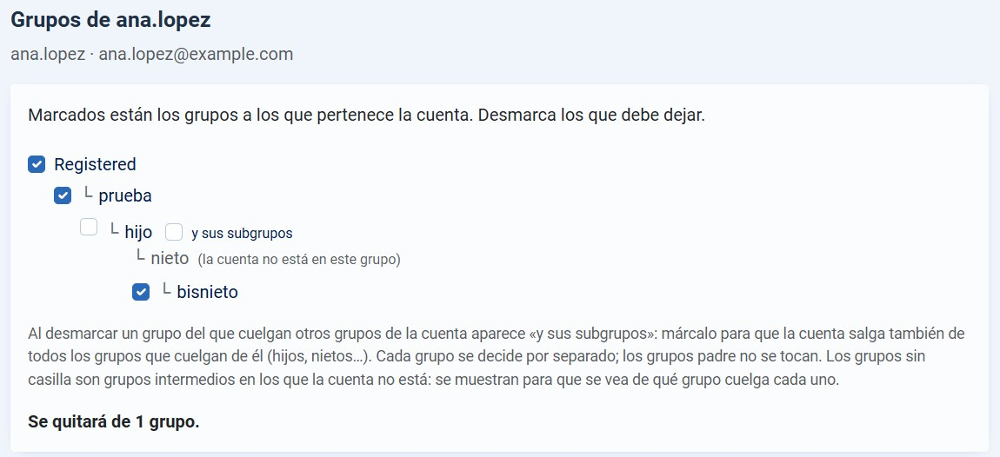

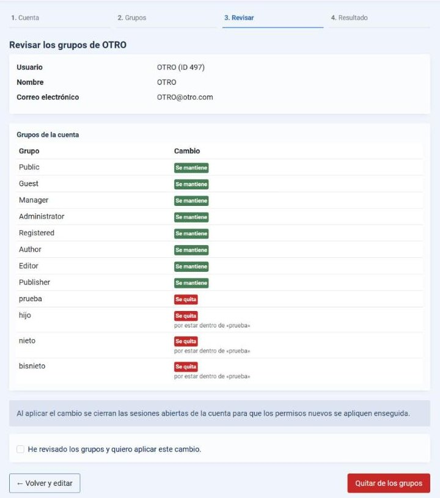

Reglas:

- **Si la cuenta se queda sin grupos**, se le asigna el grupo de los usuarios nuevos de las Opciones de Usuarios (normalmente «Registrado»). Si ese grupo es uno de los que se quitan, o cuelga de uno de ellos (heredaría sus permisos), no se cambia nada y se explica por qué.
- **Nunca cambia tu propia cuenta**: no se puede elegir en el primer paso.
- **Quien no es superusuario nunca cambia cuentas con acceso a la administración** ni superusuarios: tampoco se pueden elegir.
- **Un superusuario puede dejar de serlo** solo si queda al menos otro superusuario activo; la revisión avisa cuando la cuenta pierde ese estado o el acceso a la administración.
- «Y sus subgrupos» lo aplica también el servidor: aunque el navegador no tenga JavaScript, un grupo marcado que cuelga de uno desmarcado con esa opción se quita igualmente, y la revisión lo enseña.
- Justo antes de guardar se comprueba que los grupos de la cuenta siguen siendo los revisados; si han cambiado, no se aplica nada.
- El cambio pasa por la API de usuarios de Joomla, **cierra las sesiones abiertas** de la cuenta para que los permisos nuevos se apliquen enseguida y queda en el **registro de acciones de usuarios** con los grupos quitados y, si lo hubo, el grupo añadido.
- **Se comprueba que no quede ninguna sesión abierta.** Si alguna sobrevive, el cambio de grupos se mantiene, pero el resultado lo avisa en rojo y ofrece cerrarlas de nuevo, porque mientras siga abierta la cuenta conserva los permisos antiguos. Con «Metadatos de sesión» desactivado no se puede comprobar, y también se avisa.
- La lista de cuentas que aparece al escribir se pide al servidor con el token del formulario y el permiso de la herramienta, muestra como mucho 10 cuentas, nunca la tuya, y no cambia nada.

Requiere el permiso propio *Quitar de grupos*: los superusuarios lo tienen; a los demás hay que concedérselo en Opciones → Permisos. Se aplica a una cuenta cada vez.

## Mover grupos

Desde la 2026.10.16, **Mover grupos** cambia de una vez el grupo padre de varios grupos. En Joomla hay que editar los grupos uno a uno en Usuarios → Grupos. **Solo la pueden usar los superusuarios**, aunque otra cuenta tenga «Configurar ACL y opciones» en User Tools.

1. **Grupos y destino**: marca los grupos en el árbol y elige el nuevo grupo padre. Cada grupo se mueve con todos sus subgrupos y conserva sus miembros. Si marcas un grupo y uno de sus subgrupos, el subgrupo va con su grupo.
2. **Revisar**: por cada grupo, de qué grupo cuelga ahora, si se mueve o por qué no, cuántas cuentas afecta (las del grupo y sus subgrupos, bloqueadas incluidas) y qué **niveles de acceso** ganan y pierden sus miembros. Todavía no se ha cambiado nada. La revisión es de un solo uso, caduca a los 15 minutos y pide confirmación.
3. **Resultado**: los grupos movidos y los que se omitieron porque cambiaron después de la revisión.

Un grupo no se mueve, y la revisión dice por qué, cuando:

- **cambiaría el acceso a la administración**: si, al colgar del nuevo grupo, él o alguno de sus subgrupos ganaría o perdería el acceso a la administración o los permisos de superusuario. La revisión nombra cada grupo afectado. Esos cambios se hacen en Usuarios → Grupos, grupo a grupo;
- **cambiaría el acceso a la administración de alguna cuenta**: Joomla decide el acceso de una cuenta con todos sus grupos a la vez, así que, por ejemplo, una denegación heredada a través de un grupo puede anular el acceso que da otro. Cada cuenta de los grupos marcados se comprueba con todos sus grupos, y la revisión nombra las que cambiarían;
- es Public (la raíz) o un grupo de superusuarios, o el destino es un grupo de superusuarios;
- el destino es el propio grupo o uno de sus subgrupos;
- ya hay un grupo con el mismo nombre bajo el destino (Joomla no lo permite);
- ya cuelga de ese grupo (no hay nada que hacer).

El cambio pasa por el modelo de grupos de Joomla, el mismo de Usuarios → Grupos, así que se ejecutan sus comprobaciones y los eventos de los plugins y el árbol se recalcula. Cada grupo se comprueba de nuevo justo antes de moverlo, y cada movimiento queda en el **registro de acciones de usuarios**. Después se **cierran las sesiones abiertas** de las cuentas de los grupos movidos, para que los niveles que pierden se apliquen enseguida; si alguna sesión sobrevive, el resultado lo avisa. Tu propia sesión no se cierra.

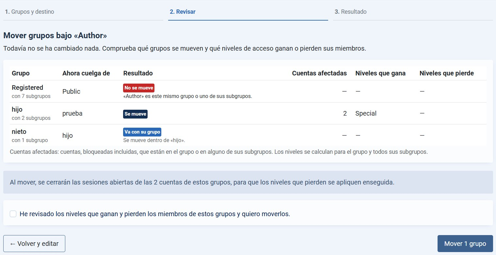

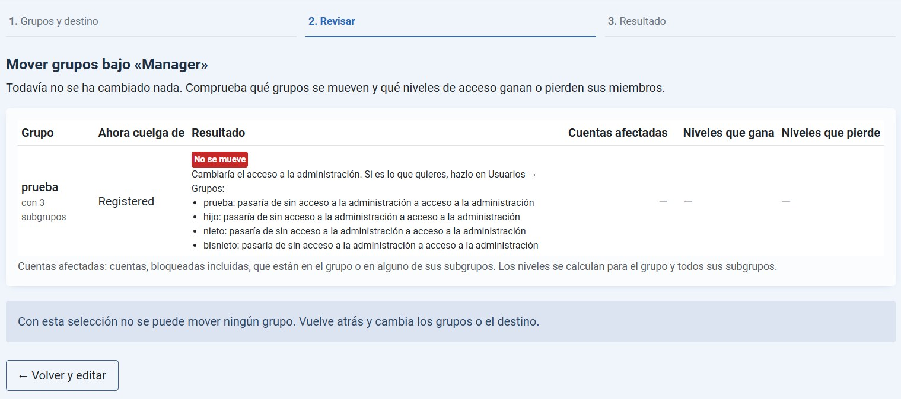

## Grupos y niveles de acceso

Desde la 2026.10.9, **Grupos y niveles de acceso** muestra en una sola tabla qué niveles de acceso de visualización tiene cada grupo de usuarios. Joomla solo enseña esta relación desde los niveles (Usuarios → Niveles de acceso, columna de grupos), sin la herencia y sin una vista por grupo. Esta pantalla solo lee: no cambia grupos, niveles ni cuentas.

- **Filas**: los grupos, en su árbol, con el número de cuentas activas asignadas directamente (enlazado con el gestor de usuarios filtrado por ese grupo) y etiquetas para superusuarios, grupos con acceso a la administración y el grupo de invitados configurado en las Opciones de Usuarios.
- **Columnas**: los niveles, en su orden. Cada celda dice si el grupo tiene el nivel:
  - **Asignado**: el grupo está asignado al nivel.
  - **Heredado**: lo está uno de sus grupos padre, que se indica. Joomla concede el nivel a todos los grupos que cuelgan de un grupo asignado; por ejemplo, «Editor» tiene el nivel *Registrado* porque cuelga de «Registrado».
  - **Siempre**: el nivel *Público*, que Joomla concede a todos aunque nadie esté asignado.
  - **—**: el grupo no tiene el nivel.
- **Resumen por nivel**: grupos asignados y cuántos grupos tienen el nivel en total. Si algún nivel tiene cuentas asignadas una a una (sin grupo), aparece además la columna «Cuentas asignadas una a una»; si no hay ninguna, se oculta. Un nivel sin grupos ni cuentas se marca «Sin grupos», porque no lo tiene nadie.

Una celda marcada se lee siempre en el mismo sentido: **los miembros del grupo de la fila pueden ver el contenido del nivel de la columna**. «Heredado del grupo «Manager»» en la columna *Registrado* de la fila «Administrator» significa que los administradores ven el contenido *Registrado* porque su grupo cuelga de Manager, que está asignado a ese nivel. No significa que quien tenga el nivel *Registrado* vea lo mismo que los administradores.

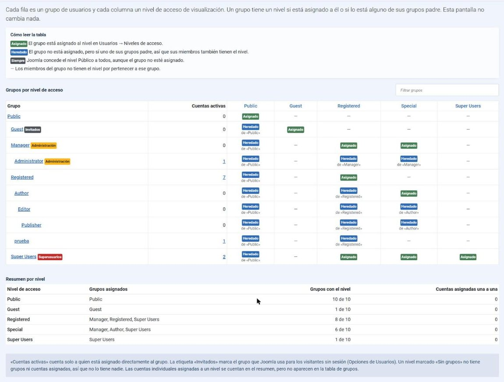

Un cuadro de búsqueda filtra los grupos. Junto a él, dos botones descargan la información en CSV (desde la 2026.10.11):

- **CSV: tabla**: la misma tabla de la pantalla, con una fila por grupo y una columna por nivel. Incluye el ID y la ruta completa de cada grupo (por ejemplo `Public / Manager / Administrator`) y las cuentas activas. Las celdas dicen «Asignado», «Heredado del grupo «…»», «Siempre» o quedan vacías.
- **CSV: una fila por nivel**: una fila por cada grupo y nivel que tiene, con las columnas ID del grupo, Grupo, Ruta, ID del nivel, Nivel de acceso, Tipo y Heredado del grupo. Es la forma más cómoda de filtrar o hacer una tabla dinámica.

Los dos ficheros están en UTF-8 con BOM y separados por punto y coma, para que Excel los abra con las tildes bien, y están protegidos contra fórmulas. Siempre incluyen todos los grupos, aunque haya un filtro escrito. Los textos van en el idioma de la administración. La descarga requiere el mismo permiso que la pantalla y el token del formulario.

Los títulos de grupos y niveles enlazan con su edición en Joomla para quien tiene el permiso de administrar Usuarios (el mismo que exige Joomla para esas pantallas), y las cifras de cuentas enlazan con el gestor de usuarios para quien puede gestionar usuarios. La pantalla requiere el permiso propio *Ver grupos, niveles y contenido por nivel*: los superusuarios lo tienen; a los demás hay que concedérselo en Opciones → Permisos.

## Contenido por nivel de acceso

Desde la 2026.10.12, **Contenido por nivel de acceso** cuenta qué elementos usa cada nivel de acceso. Joomla solo permite verlo listado a listado, con el filtro «Acceso» de cada uno, o intentando borrar el nivel, que dice en qué tablas se usa pero no qué elementos ni cuántos. Esta pantalla solo lee.

- **Filas**: los niveles, en su orden, con el total de elementos de cada uno al final. Un cuadro de búsqueda filtra los niveles, útil si hay muchos.
- **Columnas**: los tipos de elemento que tienen algún nivel asignado:
  - artículos;
  - categorías de cada componente;
  - campos y grupos de campos de cada contexto;
  - elementos de menú del sitio;
  - módulos del sitio y de la administración;
  - plugins, contactos, canales de noticias, etiquetas, idiomas de contenido y visitas guiadas.
- **Enlaces**: cada cifra enlaza al listado de Joomla ya filtrado por ese nivel, si puedes gestionar ese componente. Por ejemplo, «Categorías: Artículos» con el nivel *Socios* abre Contenido → Categorías con el filtro de acceso puesto.
- **Otras extensiones** (adjuntos, galerías…): sus tablas se detectan igual que lo hace Joomla antes de borrar un nivel, por tener una columna `access`. Aparecen como «Tabla #__nombre» y se cuentan enteras y sin enlace, porque User Tools no sabe qué significa cada fila. El índice de Búsqueda inteligente no se cuenta, porque repite los elementos anteriores.
- **Avisos**: si hay elementos con un nivel que no existe (por ejemplo, borrado directamente en la base de datos), aparecen en una fila «ID n (no existe)» y un aviso pide asignarles un nivel existente, porque nadie los ve en el sitio. Los niveles que no usa ningún elemento salen atenuados, con total 0, y se listan también debajo de la tabla.

No se cuentan los elementos en la papelera. Los listados de Joomla ocultan además los archivados salvo que cambies su filtro de estado, así que el listado puede mostrar menos elementos que la cifra. El botón **Exportar CSV** descarga la misma tabla, con una fila por nivel y su ID (UTF-8 con BOM y punto y coma). Usa el mismo permiso que «Grupos y niveles de acceso», que ahora se llama *Ver grupos, niveles y contenido por nivel*, y se llega desde la portada o con el botón «Ver contenido por nivel» de esa pantalla.

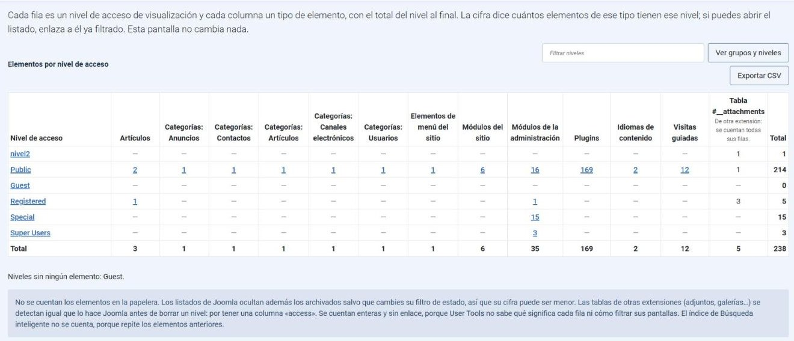

## Contenido por antigüedad

Desde la 2026.10.15, **Contenido por antigüedad** muestra cuánto contenido lleva tiempo sin tocarse. Joomla no permite filtrar el listado de artículos por fecha, así que esta pantalla hace ese recuento. Solo lee.

- **Filas**: los años en que se modificó por última vez algún elemento, del más reciente al más antiguo, con el total de cada año al final y una fila de totales.
- **Columnas**: un tipo de elemento cada una. De momento solo **artículos**; la tabla está preparada para añadir otros tipos con fecha de modificación.
- **Fecha**: la de última modificación (UTC, como la guarda Joomla). Un artículo de 2015 revisado el mes pasado cuenta en el año actual.
- **Estados**: los publicados, despublicados y archivados cuentan; los de la papelera no.
- **Filtro por nivel de acceso**: cuenta solo los elementos con ese nivel, para ver qué niveles acumulan contenido antiguo.
- **Lista de un año**: cada cifra abre los elementos de ese año y tipo, del modificado hace más tiempo al más reciente, con título, categoría, nivel de acceso, autor, estado y fechas de creación y modificación, 50 por página. El título enlaza a la edición en Joomla si puedes editarlo.

**Exportar CSV** descarga la tabla o, desde una lista, todos sus elementos (UTF-8 con BOM y punto y coma). La pantalla necesita el permiso *Ver contenido por antigüedad*; la lista de títulos requiere además poder gestionar los artículos en Joomla. El filtro, las cifras, los totales, las listas y los CSV respetan los niveles de acceso autorizados del artículo y de su categoría, como el listado de artículos de Joomla; los superusuarios globales conservan la vista completa. «Editar propios» solo muestra el enlace en artículos del propio usuario. Sin ese permiso, las cifras se ven pero sin enlace.

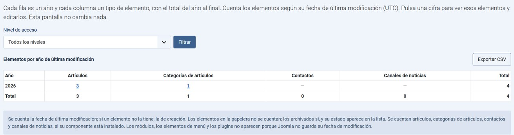

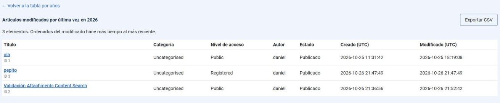

## Diagnóstico de accesos

Desde la 2026.10.15, **Diagnóstico de accesos** reúne en una pantalla las situaciones que conviene revisar en cuentas, grupos y niveles de acceso. Solo lee: no corrige permisos ni cambia cuentas. Cada comprobación aparece siempre, con o sin avisos, y cuando encuentra algo explica qué ha detectado, **por qué importa** y **cómo revisarlo**, con enlaces a la cuenta, el grupo, el nivel o el listado de Joomla correspondiente.

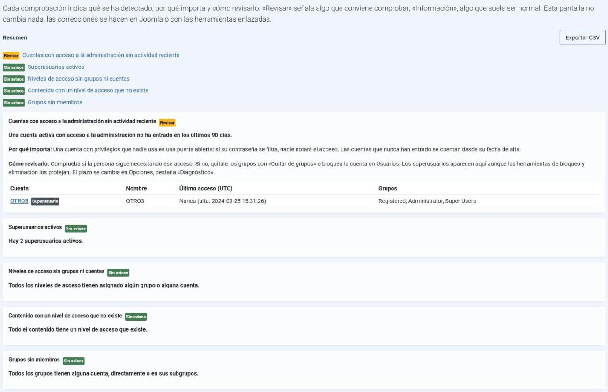

| Comprobación | Tipo | Qué señala |
|---|---|---|
| Cuentas con acceso a la administración sin actividad reciente | Revisar | Cuentas activas con acceso a la administración que no han entrado en los últimos N días (90 por defecto, en Opciones → Diagnóstico). Las que nunca han entrado se cuentan desde su alta. Incluye a los superusuarios, aunque las herramientas de bloqueo y eliminación los protejan. |
| Superusuarios activos | Revisar | Avisa si solo queda un superusuario activo: si esa cuenta se pierde, nadie puede administrar el sitio sin entrar en el servidor. |
| Niveles de acceso sin grupos ni cuentas | Revisar | Niveles, salvo Public, que no tiene asignados ningún grupo ni ninguna cuenta. Su contenido solo lo ven los superusuarios. Indica cuántos elementos los usan. |
| Contenido con un nivel de acceso que no existe | Revisar | Elementos cuyo nivel no existe, por tipo, con enlace al listado de Joomla ya filtrado por ese nivel. Nadie los ve en el sitio. Se usan las mismas tablas que en «Contenido por nivel de acceso». |
| Grupos sin miembros | Información | Grupos sin cuentas, ni directamente ni en sus subgrupos, con sus subgrupos y los niveles que los usan. No suele ser un error: Joomla trae grupos que muchos sitios no usan. Public y el grupo de invitados no se incluyen. |

El tipo aparece siempre escrito («Revisar», «Información» o «Sin avisos»), no solo con color. **Exportar CSV** descarga todos los avisos (UTF-8 con BOM y punto y coma). La pantalla necesita el permiso *Ver el diagnóstico de accesos*, y el módulo del panel de Usuarios avisa, a quien lo tiene, de cuántas comprobaciones conviene revisar.

## Seguridad

- **Los superusuarios están siempre protegidos**, en todas las herramientas y aunque se desactive «Excluir administradores». User Tools no bloquea, elimina ni anonimiza cuentas de superusuario.
- **La cuenta que ejecuta una operación manual siempre queda protegida.**
- **Cada bloqueo, cambio de grupos o anonimización cierra las sesiones abiertas** de la cuenta, como hace el gestor de usuarios de Joomla (requiere «Metadatos de sesión», activado por defecto).
- **Las altas, los bloqueos, las eliminaciones, las anonimizaciones y los cambios de grupo quedan en el registro de acciones de usuarios** (Usuarios → Registro de acciones de usuarios): quién bloqueó, creó o eliminó cada cuenta y con qué herramienta, o qué tarea programada lo hizo.
- **Permisos propios**, delegables sin dar superusuario (Opciones → Permisos):
  - *Comparar lista y bloquear*, *Crear cuentas*, *Revisar usuarios inactivos*, *Eliminar usuarios inactivos*, *Anonimizar cuentas*, *Ver resultados de tareas*, *Quitar de grupos*, *Ver grupos, niveles y contenido por nivel*, *Ver contenido por antigüedad* y *Ver el diagnóstico de accesos*.
  - Quien no es superusuario nunca puede bloquear, eliminar, anonimizar ni quitar de grupos cuentas con acceso a la administración.
- **Confirmación reforzada configurable**: a partir de N cuentas (10 por defecto) hay que escribir el número exacto de cuentas afectadas, además de marcar la casilla.
- **El borrado y la anonimización exigen siempre escribir el número de cuentas**, aunque solo sea una; el umbral configurable no desactiva esta confirmación.
- **El módulo de grupos del sitio solo lee**: nunca muestra correos ni cuentas bloqueadas, y por defecto oculta las cuentas con acceso a la administración (ver [módulo de grupos](#módulo-de-grupos-de-usuarios-en-el-sitio)).
- **Límite de seguridad en las tareas programadas** contra bloqueos masivos (ver [límite de seguridad](#límite-de-seguridad-contra-bloqueos-masivos)).
- Previsualizaciones de un solo uso que caducan a los 15 minutos, revalidación de cada cuenta justo antes de guardarla, protección CSRF y páginas que no se guardan en caché.

## Opciones

Componentes → User Tools → **Opciones** (botón de la barra de herramientas):

| Pestaña | Ajustes |
|---|---|
| Seguridad | Confirmación reforzada a partir de N cuentas (0 la desactiva); modo de alta por defecto (enlace por correo o contraseña temporal); días que se conservan los informes (90 por defecto, 0 = siempre) |
| Comparación | Excluir administradores, nombres excluidos y grupos excluidos de la comparación manual |
| Revisión de inactivos | Plazo, incluir quien nunca accedió y exclusiones de la revisión manual |
| Eliminación de inactivos | Plazo, cuentas que se listan (solo bloqueadas por defecto, ambas o solo activas), incluir quien nunca accedió y exclusiones de la eliminación |
| Anonimización | Plazo e incluir quien nunca accedió cuando se eligen las cuentas inactivas, y exclusiones de la anonimización |
| Diagnóstico | Días sin actividad tras los que una cuenta con acceso a la administración aparece en el diagnóstico de accesos (90 por defecto) |
| Permisos | Permisos de cada herramienta |

Las exclusiones de las herramientas manuales también se guardan al usarlas. Cada tarea programada tiene las suyas en su propia configuración.

## Capturas de las herramientas

Estas dos capturas se incorporaron con la herramienta de eliminación en 2026.10.5, en Joomla 6.2.0.

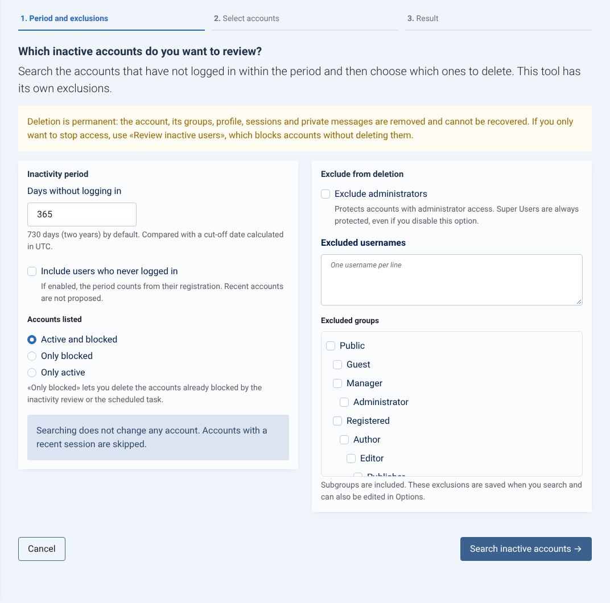

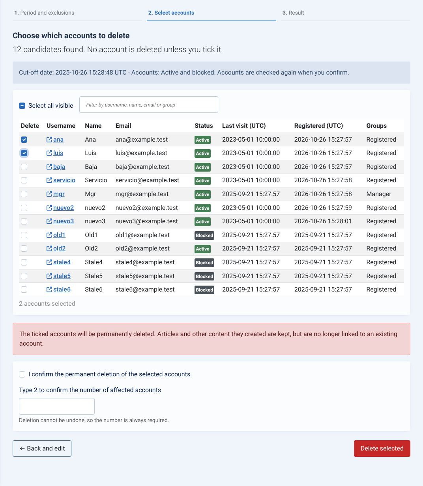

Consulta la [galería completa](docs/capturas.md) para recorrer las demás herramientas; incluye capturas de versiones anteriores.

## Desarrollo

Consulta el [mapa de arquitectura](docs/arquitectura.md) para seguir los flujos, localizar responsabilidades, entender la persistencia y elegir las pruebas relacionadas con cada cambio.

Estructura:

- `admin/`: componente con controladores, modelos, vistas MVC, plantillas y ficheros de idioma es-ES y en-GB.
- `admin/src/Service/`: lógica de dominio compartida con el plugin.
- `media/`: CSS y JS cargados con el gestor de recursos web (`joomla.asset.json`).
- `plugins/task/usertools/`: plugin de tareas.
- `modules/mod_usertools/`: módulo de resumen del panel de Usuarios.
- `modules/mod_usertools_groups/`: módulo del sitio que lista grupos y miembros.
- `package/`: manifiesto del paquete, script de instalación e idiomas.

Pruebas:

~~~sh
composer install && npm ci
vendor/bin/phpunit                    # pruebas unitarias de los servicios
npm test                              # comportamiento del JavaScript (jsdom)
JOOMLA_PATH=/ruta/a/joomla-6 vendor/bin/phpstan analyse   # análisis estático, nivel 6
~~~

La prueba de extremo a extremo `tests/integration/run.php` recorre todos los flujos contra un Joomla 6 real y desechable: comparación, altas por correo hasta elegir la contraseña y entrar, contraseñas temporales, permisos delegados, revisión y eliminación de inactivos, tarea con límite de seguridad, informes, CSV, registro de acciones y el módulo de grupos del sitio. Instrucciones de uso en la cabecera del fichero; usa `tests/integration/smtp-sink.php` como servidor de correo de pruebas.

GitHub Actions ejecuta en cada push y pull request las pruebas unitarias (PHP 8.3 y 8.4), JavaScript, PHPStan y la prueba de extremo a extremo con PostgreSQL y con MySQL.

## Construcción y publicación

La numeración sigue **año.mes.revisión**, sin cero inicial en el mes: 2026.10.0, 2026.10.1; el siguiente mes empieza en 2026.11.0. Las etiquetas llevan el prefijo v.

~~~sh
php scripts/build.php --output=dist                     # versión del manifiesto
php scripts/build.php --version=v2026.10.5 --output=dist
php tests/verify-build.php 2026.10.5 dist
~~~

Genera los cinco ZIP instalables (`pkg_usertools`, `com_usertools`, `plg_task_usertools`, `mod_usertools` y `mod_usertools_groups`), `SHA256SUMS.txt` y `updates.xml`. En Windows también vale `scripts\build.ps1`, que llama al mismo script.

Para publicar, crea una release en GitHub con una etiqueta **vAAAA.M.REVISIÓN** sobre `main` (Releases → Draft a new release → Choose a tag → Publish release). GitHub Actions pasa las pruebas, genera los paquetes con esa versión en los manifiestos y los adjunta a la release junto con `SHA256SUMS.txt` y `updates.xml`. Las instalaciones existentes ven la actualización a través del servidor de actualizaciones. No se admiten sufijos de preversión.

## Referencias

Implementación propia basada en las APIs de Joomla 6 y en el patrón de los plugins oficiales de tareas, como [DeleteActionLogs](https://github.com/joomla/joomla-cms/tree/6.0.0/plugins/task/deleteactionlogs).

Proyecto independiente, sin afiliación oficial a Joomla.
