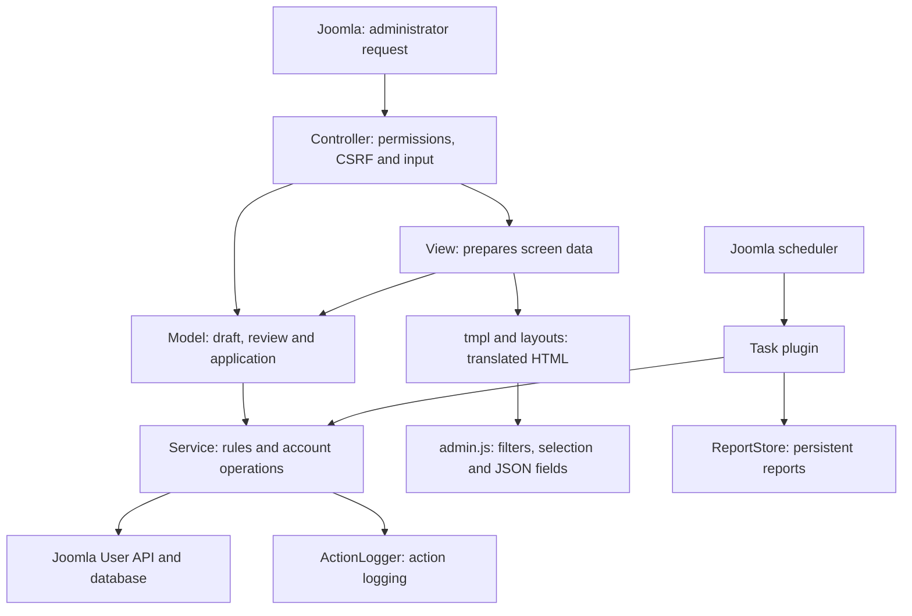

# Joomla User Tools architecture

[Español](arquitectura.md) · **English**

[Back to the README](../README.en.md#development)

This guide describes the 2026.10.5 implementation. It is intended for anyone locating a rule, following a request or modifying a tool. Update this guide whenever flows, persistence or guarantees change. Usage instructions are in the [README](../README.en.md) and [FAQ](../FAQ.en.md).

## 1. Responsibility map

Arrows represent main calls or dependencies, not a complete timeline. The plugin reuses services but does not use screen models.

| Part | Responsibility and starting point |
|---|---|
| Component registration | [admin/services/provider.php](../admin/services/provider.php) registers MVC factories and the component in Joomla's container. |
| Controllers | [DisplayController](../admin/src/Controller/DisplayController.php) authorizes views. [ToolControllerTrait](../admin/src/Controller/ToolControllerTrait.php) shares CSRF checks, permissions, POST input and notices. Each tool's controller selects its model and next screen. |
| Models | [CompareModel](../admin/src/Model/CompareModel.php), [InactiveModel](../admin/src/Model/InactiveModel.php) and [DeleteModel](../admin/src/Model/DeleteModel.php) coordinate validation, preview, revalidation and application. |
| Manual state | [ToolStateTrait](../admin/src/Model/ToolStateTrait.php) manages identity, expiry, settings signatures, typed confirmation and session results. |
| Shared rules | [Comparison](../admin/src/Service/Comparison.php), [InactivityPolicy](../admin/src/Service/InactivityPolicy.php), [Exclusions](../admin/src/Service/Exclusions.php) and [MassBlockGuard](../admin/src/Service/MassBlockGuard.php) determine matching, eligibility, protection and limits. |
| Reading Joomla data | [UserDirectory](../admin/src/Service/UserDirectory.php) queries accounts, groups and sessions; [UserRecord](../admin/src/Service/UserRecord.php) represents loaded accounts. |
| Account changes | [AccountBlocker](../admin/src/Service/AccountBlocker.php), [AccountDeleter](../admin/src/Service/AccountDeleter.php) and [Registration](../admin/src/Service/Registration.php) use Joomla's User API. [AccountMailer](../admin/src/Service/AccountMailer.php) sends password links. |
| Services and settings | [Toolkit](../admin/src/Service/Toolkit.php) builds services with Joomla dependencies. [Settings](../admin/src/Service/Settings.php) interprets options; [SettingsStore](../admin/src/Service/SettingsStore.php) saves them. |
| Presentation | Classes under admin/src/View prepare data; [ViewTrait](../admin/src/View/ViewTrait.php) shares toolbar, assets and helpers. admin/tmpl contains screens; admin/layouts contains reusable fragments. |
| Browser | [media/js/admin.js](../media/js/admin.js) filters tables, maintains selections and serializes fields. Its checks do not replace server validation. |
| Scheduled task | [Usertools](../plugins/task/usertools/src/Extension/Usertools.php) classifies accounts, applies the limit, simulates or blocks, and saves reports. |
| Evidence | [ActionLogger](../admin/src/Service/ActionLogger.php) writes to Joomla; [ReportStore](../admin/src/Service/ReportStore.php) stores task reports; [CsvExport](../admin/src/Service/CsvExport.php) prepares exports. |
| Remove from groups | [UngroupModel](../admin/src/Model/UngroupModel.php) drives the steps (account, groups, single-use review) and recomputes the review before writing; account suggestions come from `UserDirectory::search()`. [GroupRemoval](../admin/src/Service/GroupRemoval.php) decides, with no dependencies, which groups are removed (the unticked ones and, for those with “and its subgroups”, the groups below them), what is kept, whether the default group is added and whether a safety rule forbids it, and with `treeRows()` which rows make up the tree on screen (the account's groups and, without a checkbox, the intermediate groups it is not in); [AccountRegrouper](../admin/src/Service/AccountRegrouper.php) checks the groups on a freshly loaded `User`, saves through Joomla's API, closes and verifies the sessions and logs the change. In the browser, `admin.js` suggests accounts and applies “and its subgroups” group by group while ticking. |
| Move groups | [MoveModel](../admin/src/Model/MoveModel.php) drives the steps (groups and parent, single-use review, result) and recomputes the review before writing. [GroupMove](../admin/src/Service/GroupMove.php) decides, with no dependencies, which groups move, which go with their group, the levels the group and its subgroups gain and lose, and refuses moves that would change administrator access (with the root asset rule exposed by `UserDirectory::allows()`). [GroupMover](../admin/src/Service/GroupMover.php) reloads the group, saves it through Joomla's group model and logs the move. Super Users only: `DisplayController::SUPER_USERS` is checked on the root asset, never on the component's permissions. |
| Anonymise accounts | [AnonymizeModel](../admin/src/Model/AnonymizeModel.php) drives the steps (accounts, selection with a typed number, batches with a checkpoint after each account, result). [AnonymizeSelection](../admin/src/Service/AnonymizeSelection.php) decides, with no dependencies, which accounts are offered from the list, inactivity or group, which are skipped and why, and the fingerprint that must not change between review and writing. [AccountAnonymizer](../admin/src/Service/AccountAnonymizer.php) reloads the account, runs the privacy plugins' `onPrivacyCanRemoveData` and `onPrivacyRemoveData` events with an unsaved request, checks the result, removes profile, notes and custom field values, and logs the anonymisation with the ID only. |
| Undo blocks | [UnblockModel](../admin/src/Model/UnblockModel.php) lists recent batches (real task runs that blocked accounts and manual batches), opens the single-use review of one batch and unblocks the ticked accounts. Manual reviews save each batch when blocking with `ToolStateTrait::recordBatch()` in `usertools-batches` (another `ReportStore`). [BlockBatch](../admin/src/Service/BlockBatch.php) decides, with no dependencies, which accounts of the batch can be unblocked (still blocked, same username and last visit, not anonymised, and without administrator access unless the operator is a Super User); [AccountUnblocker](../admin/src/Service/AccountUnblocker.php) repeats that check on a freshly loaded `User`, saves through Joomla's API and logs the unblock with its batch. |
| Groups and access levels | [AccessModel](../admin/src/Model/AccessModel.php) reads groups, levels and active accounts per group through [UserDirectory](../admin/src/Service/UserDirectory.php); [AccessMatrix](../admin/src/Service/AccessMatrix.php) decides, with the rules of `Access::getAuthorisedViewLevels()`, whether each group has each level assigned, inherited or always (Public), and prepares the rows of the two CSV exports, which [AccessController](../admin/src/Controller/AccessController.php) downloads through [CsvExport](../admin/src/Service/CsvExport.php) after checking the token and the permission. Read only. |
| Content by access level | [AccessUsageReader](../admin/src/Service/AccessUsageReader.php) counts per level Joomla's items (with their state, client and component) and any other table with an `access` column, as Joomla does before deleting a level; [AccessUsage](../admin/src/Service/AccessUsage.php) builds the table, detects missing levels and exports it. [UsageModel](../admin/src/Model/UsageModel.php) and [UsageController](../admin/src/Controller/UsageController.php) (CSV). Read only, with the `usertools.access` permission. |
| Content by age | [ContentAgeReader](../admin/src/Service/ContentAgeReader.php) counts per year of last modification the items of each kind declared in `KINDS` (articles, article categories, contacts and news feeds, each with its own columns; trash excluded; not modules, menus or plugins, because Joomla stores no modification date for them) and reads those of one year with their category (the parent, for categories), level and author; [ContentAge](../admin/src/Service/ContentAge.php) builds the table by year, validates year and page, and exports. [AgeModel](../admin/src/Model/AgeModel.php) and [AgeController](../admin/src/Controller/AgeController.php) (CSV). Read only, with the `usertools.content` permission; the list of titles also requires `core.manage` on the content's component. AgeModel passes the user’s authorized viewing levels to ContentAgeReader (unrestricted only for global Super Users). The shared base query filters item and category access (for categories, only their own, as Joomla's category list does: `categoryAccess`) consistently for counts, totals, pages and CSV. The list receives `created_by` and checks ownership before showing `core.edit.own` links. |
| Access diagnosis | [AccessHealth](../admin/src/Service/AccessHealth.php) gathers the checks (accounts with administrator access and no activity, active Super Users, levels with no groups or accounts, content with missing levels and groups with no members) from [UserDirectory](../admin/src/Service/UserDirectory.php), [AccessMatrix](../admin/src/Service/AccessMatrix.php) and [AccessUsage](../admin/src/Service/AccessUsage.php), and exports them. `Toolkit::accessHealth()` computes them for [DiagnoseModel](../admin/src/Model/DiagnoseModel.php), [DiagnoseController](../admin/src/Controller/DiagnoseController.php) (CSV) and the dashboard module, which shows how many are worth reviewing. Read only, with the `usertools.diagnose` permission. |
| Site groups module | [Dispatcher](../modules/mod_usertools_groups/src/Dispatcher/Dispatcher.php) picks the mode; [MembershipHelper](../modules/mod_usertools_groups/src/Helper/MembershipHelper.php) reads memberships and members with a fixed number of queries and never writes; [GroupTree](../modules/mod_usertools_groups/src/Service/GroupTree.php) holds the pure group-tree rules (inheritance, subgroups, groups with administrator access and how each member is shown). It does not depend on the component. |

## 2. Following a manual operation

### Example: deleting inactive accounts

1. Joomla displays the delete view. DisplayController requires the view permission; [Delete/HtmlView](../admin/src/View/Delete/HtmlView.php) obtains the draft and groups from the model and prepares the template.
2. On search, [DeleteController::search()](../admin/src/Controller/DeleteController.php) checks the token and usertools.delete permission. DeleteModel::search() validates the period, saves options and calculates candidates using InactivityPolicy, Exclusions and recent sessions.
3. The model stores a session preview: offered IDs, UTC cutoff, exclusions, status filter, settings signature, identity, nonce and expiry. It redirects to review.
4. DeleteModel::getReview() queries candidates again and only shows accounts offered in the preview. It does not add accounts that have since become eligible.
5. The browser submits selected IDs as JSON. DeleteController::delete() checks token and permission again. The model validates the preview, membership of the IDs, confirmation checkbox and typed count, required even for one account.
6. The model consumes the preview before writing. It recalculates eligibility; AccountDeleter reloads each account, checks protection and criteria, and calls User::delete(). Joomla dispatches its user-plugin events.
7. Each successful deletion is passed to ActionLogger. The model collects deleted accounts, errors and the skipped count, stores the temporary result and the controller redirects to the result screen.

### Differences in other tools

- **Comparison:** CompareModel calculates missing and unknown usernames. A changed set offered for blocking requires a new review. It validates the entire account-creation selection before blocking or creating; creation also requires usertools.create.
- **Account creation:** CompareModel temporarily disables the Joomla user plugin's email and restores its configuration in finally. Registration creates accounts in Registered; AccountMailer sends the link, or a temporary password is returned. Each creation is written to the action log as soon as the account exists.
- **Batched application:** when applying, CompareModel consumes the preview and stores a job in the session with the IDs to block and the usernames and emails to create, never passwords. `step()` processes accounts for `Settings::batchSeconds()` seconds (8 by default, counted from the start of the request, and at least one account), and the first batch runs in the apply request itself. The progress screen asks `compare.step` for the rest; it checks the token and the permission and answers in JSON, and temporary passwords travel only in the response of the batch that created them. The job is saved after each account (a creation leaves the queue as soon as the account exists), so a request that is cut off repeats nothing when continuing; before creating, each batch checks `usertools.create` again and that the Registered group still exists without administrator access. `discard()` ends the job and leaves the rest untouched. There can be only one job per session and it belongs to whoever started it.
- **Temporary passwords:** [CompareController::apply()](../admin/src/Controller/CompareController.php) renders the result directly in the application response when passwords are present. The session copy is redacted and cannot recover them on reload.
- **Inactivity review:** InactiveModel uses explicit account selection and AccountBlocker. It skips blocked accounts and recent sessions. Accounts no longer meeting criteria are not replaced by others.

## 3. Following the scheduled task

The plugin's blockInactive() method receives parameters and task identity from the scheduler:

1. Loads the component and builds services. Creates a report before changing accounts; blocking does not start if the report cannot be written.
2. Uses Operator::system(): a visitor triggering the scheduler does not become the operation's actor.
3. Classifies enabled accounts, protections and omission reasons. Removes candidates with recent sessions.
4. MassBlockGuard compares candidates with enabled accounts. Exceeding the limit blocks nothing in real mode; dry-run mode reports the excess.
5. Simulates or calls AccountBlocker to revalidate and block each account. Saves progress every 50 processed accounts in the real-operation loop.
6. Finalizes the report and applies retention. Returns success or failure to the scheduler. A report-update error also causes failure.

Reports and the action log are separate evidence sources. A dry run does not create real blocking actions in the log.

## 4. Where data lives

| Data | Location and lifetime |
|---|---|
| Manual draft | Session, under tool-specific keys. Preserves input for editing; it does not have the preview's separate 15-minute expiry. |
| Preview | Session; 900 seconds, tied to the actor and a nonce. Relevant settings are checked through a signature. Consumed before application. |
| Manual result | Session; 900 seconds, tied to the actor. Temporary passwords are removed from the stored copy. This is not persistent history. |
| Manual options | Component parameters in #__extensions, through SettingsStore. Shared across the site, with separate keys per tool. Searching can also save options. |
| Scheduled parameters | Each Joomla task's configuration; exclusions are independent of manual tools. |
| Accounts | Joomla user tables and API; blocks, creations and deletions use the API to run events. |
| Action log | Joomla's log, through ActionLogger. Contains no passwords. Writing may fail without stopping the account change. |
| Scheduled reports | usertools-reports subfolder of the logs directory. PHP files with a denial header and JSON body. Retention is configured in Options and applied when tasks finish. |
| Temporary password | Generated in memory and shown in the creation response. Joomla retains the authentication hash, not the clear-text password. |

ReportStore validates file IDs and writes through a temporary file followed by a rename. The report's version property identifies its format; it is not the extension version.

## 5. Rules every change must preserve

- Check permissions per view and action, and CSRF tokens for change requests. Component access requires core.manage; tool permissions are in [admin/access.xml](../admin/access.xml).
- Preserve Super User and manual-operator protection. Non-Super Users cannot block or delete accounts with administrator access.
- Revalidate each account before changing it. A preview does not guarantee that its state remains unchanged.
- Apply only accounts offered and selected according to the flow. Never silently expand a review.
- Consume the preview before writes. This prevents reuse; it does not make the whole operation transactional.
- Keep dates in UTC and use a strictly earlier-than-cutoff comparison; use registration dates when including never-logged-in accounts.
- Use Joomla's API for changes and preserve plugin events.
- Do not persist or log clear-text passwords, or return plugin diagnostics that could contain them.
- Preserve template escaping, translatable text and non-cacheable sensitive responses.
- Preserve initial dry-run mode, the scheduled safety limit and mandatory typed confirmation for deletion.

## 6. Partial failures and current limits

Operations are not atomic: changes already applied remain if a later account fails. Services turn certain failures into per-account results; an unexpected interruption may prevent the manual summary from being saved.

ActionLogger discards exceptions so audit failures do not stop an operation. A changed account therefore does not guarantee a corresponding log entry. Task reports have checkpoints and may also remain incomplete if execution stops between saves.

Manual results retain only the skipped count, not a persistent per-account explanation. Scheduled reports retain actions and protections in detail, and summarize omissions by reason. There is currently no common ID connecting all manual actions in a batch.

These are limits of the current implementation, not guarantees of complete auditing or automatic recovery. A future persistent history must explicitly address these cases.

## 7. Where to make changes and what to check

| Change | Main files | Related tests |
|---|---|---|
| Normalization and comparison | Comparison, CompareModel | [ComparisonTest](../tests/Unit/ComparisonTest.php), [MvcRegressionTest](../tests/Unit/MvcRegressionTest.php) and integration |
| Protection and groups | Exclusions, UserDirectory, Operator | [ExclusionsTest](../tests/Unit/ExclusionsTest.php), SafetyTest, DeleteTest and delegated-permission integration |
| Dates, inactivity and selection | InactivityPolicy, InactiveSelection, manual models and plugin | [PolicyTest](../tests/Unit/PolicyTest.php), DeleteTest and integration |
| Blocking, passwords and limits | AccountBlocker, PasswordGenerator, MassBlockGuard | [SafetyTest](../tests/Unit/SafetyTest.php) and integration |
| Deletion | DeleteModel, AccountDeleter, delete templates | [DeleteTest](../tests/Unit/DeleteTest.php), MvcRegressionTest and integration |
| Creation, reports or CSV | Registration, AccountMailer, ReportStore, CsvExport | [RecordsTest](../tests/Unit/RecordsTest.php) and integration |
| Permissions, routes or previews | Controllers and ToolStateTrait | MvcRegressionTest, which runs [tests/regression/mvc.php](../tests/regression/mvc.php), and integration |
| Filters, selection and confirmation | admin.js, templates and layouts | [tests/js/admin.test.js](../tests/js/admin.test.js); also check keyboard interaction, filters and hidden selected accounts in a browser |
| Remove from groups | GroupRemoval, AccountRegrouper, UngroupModel, UngroupController, ungroup templates, admin.js | [GroupRemovalTest](../tests/Unit/GroupRemovalTest.php), [tests/js/admin.test.js](../tests/js/admin.test.js), MvcRegressionTest and the “Remove from groups” integration section |
| Move groups | GroupMove, GroupMover, MoveModel, MoveController, move templates | [GroupMoveTest](../tests/Unit/GroupMoveTest.php), MvcRegressionTest and the “Move groups” integration section |
| Anonymise accounts | AnonymizeSelection, AccountAnonymizer, AnonymizeModel, AnonymizeController, anonymize templates | [AnonymizeSelectionTest](../tests/Unit/AnonymizeSelectionTest.php), MvcRegressionTest and the “Anonymize accounts” integration section |
| Undo blocks | BlockBatch, AccountUnblocker, UnblockModel, UnblockController, unblock templates, undo layout | [BlockBatchTest](../tests/Unit/BlockBatchTest.php), MvcRegressionTest and the “Undo blocks” integration section |
| Content by access level | AccessUsage, AccessUsageReader, UsageModel, UsageController, usage template | [AccessUsageTest](../tests/Unit/AccessUsageTest.php), MvcRegressionTest and the “Content by access level” integration section |
| Content by age | ContentAge, ContentAgeReader, AgeModel, AgeController, age templates | [ContentAgeTest](../tests/Unit/ContentAgeTest.php), MvcRegressionTest and the “Content by age” integration section |
| Access diagnosis | AccessHealth, DiagnoseModel, DiagnoseController, diagnose template | [AccessHealthTest](../tests/Unit/AccessHealthTest.php), MvcRegressionTest and the “Access diagnosis” integration section |
| Groups and access levels | AccessMatrix, AccessModel, AccessController, UserDirectory, access template | [AccessMatrixTest](../tests/Unit/AccessMatrixTest.php), MvcRegressionTest and the “Groups and access levels” integration section |
| Site groups module | mod_usertools_groups (GroupTree, MembershipHelper, template) | [GroupTreeTest](../tests/Unit/GroupTreeTest.php) and the “Groups module on the site” integration section |
| Packaging and installation | Manifests, package and scripts/build.php | [tests/verify-build.php](../tests/verify-build.php) and package installation in Joomla |

Commands are in [Development](../README.en.md#development) and [Building and publishing](../README.en.md#building-and-publishing). The header of [tests/integration/run.php](../tests/integration/run.php) explains how to test against a disposable Joomla site: these tests create, block and delete accounts.

[CI](../.github/workflows/ci.yml) combines PHPUnit on PHP 8.3/8.4, JavaScript with jsdom, PHPStan and HTTP flows against Joomla with MySQL/PostgreSQL. Those HTTP flows do not run a browser or replace visual checks.
