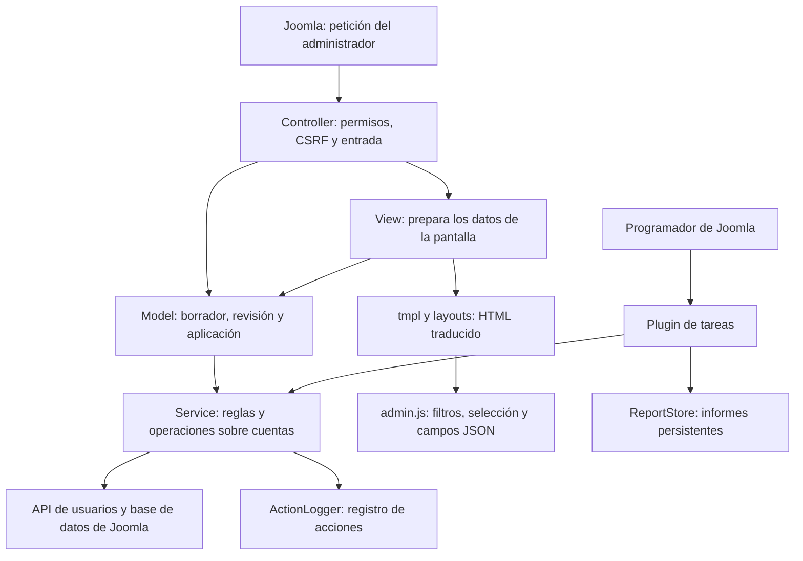

# Arquitectura de Joomla User Tools

**Español** · [English](architecture.en.md)

[Volver al README](../README.md#desarrollo)

Esta guía describe la implementación de 2026.10.5. Está dirigida a quien necesite localizar una regla, seguir una petición o modificar una herramienta. Al cambiar los flujos, la persistencia o las garantías, actualiza también esta guía. Las instrucciones de uso están en el [README](../README.md) y la [FAQ](../FAQ.md).

## 1. Mapa de responsabilidades

Las flechas indican llamadas o dependencias principales, no una secuencia temporal completa. El plugin reutiliza servicios, pero no pasa por los modelos de las pantallas.

| Parte | Responsabilidad y punto de lectura |
|---|---|
| Registro del componente | [admin/services/provider.php](../admin/services/provider.php) registra las fábricas MVC y el componente en el contenedor de Joomla. |
| Controladores | [DisplayController](../admin/src/Controller/DisplayController.php) autoriza las vistas. [ToolControllerTrait](../admin/src/Controller/ToolControllerTrait.php) comparte comprobación CSRF, permisos, lectura de POST y avisos. Los controladores de cada herramienta eligen el modelo y la siguiente pantalla. |
| Modelos | [CompareModel](../admin/src/Model/CompareModel.php), [InactiveModel](../admin/src/Model/InactiveModel.php) y [DeleteModel](../admin/src/Model/DeleteModel.php) coordinan validación, previsualización, revalidación y aplicación. |
| Estado manual | [ToolStateTrait](../admin/src/Model/ToolStateTrait.php) gestiona identidad, caducidad, firma de opciones, confirmación numérica y resultados en sesión. |
| Reglas compartidas | [Comparison](../admin/src/Service/Comparison.php), [InactivityPolicy](../admin/src/Service/InactivityPolicy.php), [Exclusions](../admin/src/Service/Exclusions.php) y [MassBlockGuard](../admin/src/Service/MassBlockGuard.php) deciden coincidencias, elegibilidad, protección y límites. |
| Lectura de Joomla | [UserDirectory](../admin/src/Service/UserDirectory.php) consulta cuentas, grupos y sesiones; [UserRecord](../admin/src/Service/UserRecord.php) representa las cuentas leídas. |
| Cambios de cuentas | [AccountBlocker](../admin/src/Service/AccountBlocker.php), [AccountDeleter](../admin/src/Service/AccountDeleter.php) y [Registration](../admin/src/Service/Registration.php) usan la API de usuarios de Joomla. [AccountMailer](../admin/src/Service/AccountMailer.php) envía el enlace de contraseña. |
| Servicios y opciones | [Toolkit](../admin/src/Service/Toolkit.php) construye los servicios con dependencias de Joomla. [Settings](../admin/src/Service/Settings.php) interpreta opciones; [SettingsStore](../admin/src/Service/SettingsStore.php) las guarda. |
| Presentación | Las clases bajo admin/src/View preparan datos; [ViewTrait](../admin/src/View/ViewTrait.php) comparte barra, recursos y helpers. admin/tmpl contiene pantallas y admin/layouts fragmentos reutilizables. |
| Navegador | [media/js/admin.js](../media/js/admin.js) filtra tablas, mantiene selecciones y serializa campos. Sus comprobaciones no sustituyen las del servidor. |
| Tarea programada | [Usertools](../plugins/task/usertools/src/Extension/Usertools.php) clasifica cuentas, aplica el límite, simula o bloquea y guarda informes. |
| Evidencias | [ActionLogger](../admin/src/Service/ActionLogger.php) escribe en Joomla; [ReportStore](../admin/src/Service/ReportStore.php) conserva informes de tareas; [CsvExport](../admin/src/Service/CsvExport.php) prepara exportaciones. |
| Quitar de grupos | [UngroupModel](../admin/src/Model/UngroupModel.php) guía los pasos (cuenta, grupos, revisión de un solo uso) y vuelve a calcular la revisión antes de escribir; las sugerencias de cuentas salen de `UserDirectory::search()`. [GroupRemoval](../admin/src/Service/GroupRemoval.php) decide, sin dependencias, qué grupos se quitan (los desmarcados y, para los que tienen «y sus subgrupos», los que cuelgan de ellos), qué se conserva, si se añade el grupo por defecto y si una regla de seguridad lo impide, y con `treeRows()` qué filas forman el árbol de la pantalla (los grupos de la cuenta y, sin casilla, los intermedios en los que no está); [AccountRegrouper](../admin/src/Service/AccountRegrouper.php) comprueba los grupos con un `User` recién cargado, guarda con la API de Joomla, cierra y verifica las sesiones y anota el cambio. En el navegador, `admin.js` sugiere cuentas y aplica «y sus subgrupos» grupo a grupo al marcar. |
| Mover grupos | [MoveModel](../admin/src/Model/MoveModel.php) guía los pasos (grupos y destino, revisión de un solo uso, resultado) y vuelve a calcular la revisión antes de escribir. [GroupMove](../admin/src/Service/GroupMove.php) decide, sin dependencias, qué grupos se mueven, cuáles van con su grupo, los niveles que ganan y pierden el grupo y sus subgrupos, y rechaza los movimientos que cambiarían el acceso a la administración (con la regla del activo raíz que expone `UserDirectory::allows()`). [GroupMover](../admin/src/Service/GroupMover.php) recarga el grupo, guarda con el modelo de grupos de Joomla y anota el movimiento. Solo superusuarios: `DisplayController::SUPER_USERS` se comprueba en el activo raíz, nunca en los permisos del componente. |
| Anonimizar cuentas | [AnonymizeModel](../admin/src/Model/AnonymizeModel.php) guía los pasos (cuentas, selección con número escrito, tandas con punto de control tras cada cuenta, resultado). [AnonymizeSelection](../admin/src/Service/AnonymizeSelection.php) decide, sin dependencias, qué cuentas se ofrecen según la lista, la inactividad o el grupo, cuáles se omiten y por qué, y la huella que no debe cambiar entre la revisión y la escritura. [AccountAnonymizer](../admin/src/Service/AccountAnonymizer.php) recarga la cuenta, ejecuta los eventos `onPrivacyCanRemoveData` y `onPrivacyRemoveData` de los plugins de privacidad con una solicitud sin guardar, comprueba el resultado, borra perfil, notas y valores de campos personalizados, y anota la anonimización solo con el ID. |
| Deshacer bloqueos | [UnblockModel](../admin/src/Model/UnblockModel.php) lista las tandas recientes (ejecuciones reales de la tarea con bloqueos y tandas manuales), abre la revisión de un solo uso de una tanda y desbloquea las cuentas marcadas. Las revisiones manuales guardan cada tanda al bloquear con `ToolStateTrait::recordBatch()` en `usertools-batches` (otro `ReportStore`). [BlockBatch](../admin/src/Service/BlockBatch.php) decide, sin dependencias, qué cuentas de la tanda se pueden desbloquear (siguen bloqueadas, mismo usuario y último acceso, sin anonimizar, y sin acceso a la administración si quien opera no es superusuario); [AccountUnblocker](../admin/src/Service/AccountUnblocker.php) repite esa comprobación con un `User` recién cargado, guarda con la API de Joomla y anota el desbloqueo con la tanda. |
| Grupos y niveles de acceso | [AccessModel](../admin/src/Model/AccessModel.php) lee grupos, niveles y cuentas activas por grupo con [UserDirectory](../admin/src/Service/UserDirectory.php); [AccessMatrix](../admin/src/Service/AccessMatrix.php) decide, con las reglas de `Access::getAuthorisedViewLevels()`, si cada grupo tiene cada nivel asignado, heredado o siempre (Público), y prepara las filas de las dos exportaciones CSV, que [AccessController](../admin/src/Controller/AccessController.php) descarga con [CsvExport](../admin/src/Service/CsvExport.php) tras comprobar el token y el permiso. Solo lectura. |
| Contenido por nivel de acceso | [AccessUsageReader](../admin/src/Service/AccessUsageReader.php) cuenta por nivel los elementos de Joomla (con su estado, cliente y componente) y cualquier otra tabla con columna `access`, como hace Joomla antes de borrar un nivel; [AccessUsage](../admin/src/Service/AccessUsage.php) arma la tabla, detecta niveles inexistentes y la exporta. [UsageModel](../admin/src/Model/UsageModel.php) y [UsageController](../admin/src/Controller/UsageController.php) (CSV). Solo lectura, con el permiso `usertools.access`. |
| Contenido por antigüedad | [ContentAgeReader](../admin/src/Service/ContentAgeReader.php) cuenta por año de última modificación los elementos de cada tipo declarado en `KINDS` (artículos, categorías de artículos, contactos y canales de noticias, cada uno con sus columnas; sin papelera; módulos, menús y plugins no, porque Joomla no guarda su fecha de modificación) y lee los de un año con su categoría (la padre, en las categorías), nivel y autor; [ContentAge](../admin/src/Service/ContentAge.php) arma la tabla por años, valida año y página, y exporta. [AgeModel](../admin/src/Model/AgeModel.php) y [AgeController](../admin/src/Controller/AgeController.php) (CSV). Solo lectura, con el permiso `usertools.content`; la lista de títulos exige además `core.manage` en el componente del contenido. AgeModel pasa los niveles autorizados del usuario a ContentAgeReader (sin restricción solo para superusuarios globales). La consulta base filtra el acceso del elemento y la categoría (en las categorías, solo el suyo, como el listado de categorías de Joomla: `categoryAccess`) para cifras, totales, páginas y CSV por igual. La lista recibe `created_by` y comprueba la propiedad antes de mostrar enlaces con `core.edit.own`. |
| Diagnóstico de accesos | [AccessHealth](../admin/src/Service/AccessHealth.php) reúne las comprobaciones (cuentas con acceso a la administración sin actividad, superusuarios activos, niveles sin grupos ni cuentas, contenido con niveles inexistentes y grupos sin miembros) a partir de [UserDirectory](../admin/src/Service/UserDirectory.php), [AccessMatrix](../admin/src/Service/AccessMatrix.php) y [AccessUsage](../admin/src/Service/AccessUsage.php), y las exporta. `Toolkit::accessHealth()` las calcula para [DiagnoseModel](../admin/src/Model/DiagnoseModel.php), [DiagnoseController](../admin/src/Controller/DiagnoseController.php) (CSV) y el módulo del panel, que muestra cuántas conviene revisar. Solo lectura, con el permiso `usertools.diagnose`. |
| Recorridos guiados | [GuidedTours](../admin/src/Service/GuidedTours.php) define un recorrido por herramienta que cambia cuentas o grupos: pasos de solo explicación que apuntan a atributos `data-ut-tour` y textos en un archivo de idioma por recorrido (`com_usertools.tour_<vista>.ini`). [script.php](../package/script.php) los crea o actualiza (conserva estado, nivel e idioma) y los elimina al desinstalar. [ViewTrait](../admin/src/View/ViewTrait.php) añade el botón junto a Ayuda solo en la primera pantalla, con el recorrido publicado y visible para el usuario; la vista ya exige el permiso de la herramienta. Joomla no filtra los recorridos por permisos propios, así que no se declaran como recorridos de contexto del componente. |
| Módulo de grupos del sitio | [Dispatcher](../modules/mod_usertools_groups/src/Dispatcher/Dispatcher.php) elige el modo; [MembershipHelper](../modules/mod_usertools_groups/src/Helper/MembershipHelper.php) lee pertenencias y miembros con un número fijo de consultas, sin escribir nada; [GroupTree](../modules/mod_usertools_groups/src/Service/GroupTree.php) contiene las reglas puras del árbol de grupos (herencia, subgrupos, grupos con acceso a la administración y forma de mostrar a cada miembro). No depende del componente. |

## 2. Seguir una operación manual

### Ejemplo: eliminar cuentas inactivas

1. Joomla muestra la vista delete. DisplayController exige el permiso de la vista; [Delete/HtmlView](../admin/src/View/Delete/HtmlView.php) obtiene el borrador y los grupos del modelo y prepara la plantilla.
2. Al buscar, [DeleteController::search()](../admin/src/Controller/DeleteController.php) comprueba token y permiso usertools.delete. DeleteModel::search() valida el plazo, guarda opciones y calcula candidatos con InactivityPolicy, Exclusions y las sesiones recientes.
3. El modelo guarda una previsualización en sesión: IDs ofrecidos, fecha límite UTC, exclusiones, filtro de estado, firma de opciones, identidad, nonce y caducidad. Se redirige a la revisión.
4. DeleteModel::getReview() vuelve a consultar los candidatos y muestra solo cuentas que estaban en la previsualización. No añade otras que hayan pasado a ser elegibles.
5. El navegador envía los IDs seleccionados como JSON. DeleteController::delete() vuelve a comprobar token y permiso. El modelo valida la previsualización, pertenencia de los IDs, casilla y número escrito, obligatorio desde una cuenta.
6. El modelo consume la previsualización antes de escribir. Recalcula elegibilidad y AccountDeleter carga cada cuenta de nuevo, comprueba protección y criterios, y llama a User::delete(). Joomla dispara los eventos de sus plugins de usuarios.
7. Cada borrado correcto se entrega a ActionLogger. El modelo acumula eliminadas, errores y cantidad omitida, guarda el resultado temporal y el controlador redirige a la pantalla de resultado.

### Diferencias de las otras herramientas

- **Comparación:** CompareModel calcula ausentes y nombres desconocidos. Si cambia el conjunto ofrecido para bloqueo, exige una nueva revisión. Valida toda la selección de altas antes de bloquear o crear; crear requiere además usertools.create.
- **Altas:** CompareModel desactiva temporalmente el correo del plugin de usuarios Joomla y restaura su configuración con finally. Registration crea cuentas en Registrados; AccountMailer envía el enlace o se devuelve una contraseña temporal. Cada alta se anota en el registro de acciones en cuanto existe la cuenta.
- **Aplicación por tandas:** al aplicar, CompareModel consume la previsualización y guarda en la sesión un trabajo con los ID que bloquear y los usuarios y correos que crear, nunca contraseñas. `step()` procesa cuentas durante `Settings::batchSeconds()` segundos (8 por defecto, contados desde el inicio de la petición, y al menos una cuenta) y la primera tanda se ejecuta en la propia petición de aplicar. El resto lo pide la pantalla de progreso a `compare.step`, que comprueba el token y el permiso y responde en JSON; las contraseñas temporales solo viajan en la respuesta de la tanda que las creó. El trabajo se guarda tras cada cuenta (una alta sale de la cola en cuanto existe), así que una petición cortada no repite nada al continuar; antes de crear, cada tanda vuelve a comprobar `usertools.create` y que el grupo Registrados siga existiendo sin acceso a la administración. `discard()` termina el trabajo y deja sin tocar lo pendiente. Solo puede haber un trabajo por sesión y pertenece a quien lo inició.
- **Contraseñas temporales:** [CompareController::apply()](../admin/src/Controller/CompareController.php) presenta el resultado en la respuesta de aplicación cuando hay contraseñas. La copia de sesión está redactada y no permite recuperarlas al volver a cargar.
- **Revisión de inactivos:** InactiveModel usa la selección explícita de cuentas y AccountBlocker. Omite cuentas ya bloqueadas y sesiones recientes. Las cuentas que dejan de cumplir criterios no se sustituyen por otras.

## 3. Seguir la tarea programada

El método blockInactive() del plugin recibe los parámetros y la identidad de la tarea del programador:

1. Carga el componente y construye los servicios. Crea un informe antes de modificar cuentas; si no puede escribirlo, no empieza los bloqueos.
2. Usa Operator::system(): el visitante que active el programador no se convierte en ejecutor de la operación.
3. Clasifica cuentas habilitadas, protecciones y motivos de omisión. Retira candidatos con sesión reciente.
4. MassBlockGuard compara los candidatos con las cuentas habilitadas. Si supera el límite en modo real, no bloquea ninguna; en simulación informa del exceso.
5. Simula o llama a AccountBlocker para revalidar y bloquear cada cuenta. Guarda avances cada 50 cuentas procesadas en el bucle real.
6. Finaliza el informe y aplica la retención. Devuelve al programador el estado de éxito o fallo. Un error al actualizar el informe también produce fallo.

El informe y el registro de acciones son evidencias distintas. La simulación no crea bloqueos reales en el registro.

## 4. Dónde viven los datos

| Dato | Ubicación y duración |
|---|---|
| Borrador manual | Sesión, en claves de cada herramienta. Conserva entradas para volver a editar; no tiene el plazo propio de 15 minutos de las previsualizaciones. |
| Previsualización | Sesión; 900 segundos, ligada al actor y a un nonce. Las opciones relevantes se contrastan mediante firma. Se consume antes de aplicar. |
| Resultado manual | Sesión; 900 segundos y ligado al actor. Las contraseñas temporales se eliminan de la copia guardada. No es un historial persistente. |
| Opciones manuales | Parámetros del componente en #__extensions, mediante SettingsStore. Son compartidas por el sitio, con claves separadas por herramienta. Buscar también puede guardar opciones. |
| Parámetros programados | Configuración de cada tarea de Joomla; sus exclusiones son independientes de las manuales. |
| Cuentas | Tablas y API de usuarios de Joomla; las operaciones de bloqueo, creación y borrado pasan por esa API para ejecutar eventos. |
| Registro de acciones | Registro de Joomla, mediante ActionLogger. No contiene contraseñas. Su escritura puede fallar sin interrumpir el cambio de cuenta. |
| Informes programados | Subcarpeta usertools-reports del directorio de logs. Archivos PHP con cabecera de denegación y cuerpo JSON. Retención configurada en Opciones, aplicada al finalizar tareas. |
| Contraseña temporal | Se genera en memoria y se muestra en la respuesta de creación. Joomla conserva el hash necesario para autenticar, no la contraseña en claro. |

ReportStore valida los IDs de archivo y escribe mediante temporal y renombrado. La propiedad version del informe identifica su formato; no debe confundirse con la versión de la extensión.

## 5. Reglas que debe preservar cualquier cambio

- Comprobar permiso por vista y por acción, y token CSRF en las peticiones de cambio. El acceso al componente requiere core.manage; los permisos propios están en [admin/access.xml](../admin/access.xml).
- Mantener la protección de superusuarios y del operador manual. Un operador sin superusuario no puede bloquear ni borrar cuentas con acceso administrativo.
- Revalidar cada cuenta antes de cambiarla. Una previsualización no garantiza que su estado siga siendo el mismo.
- Aplicar solo cuentas ofrecidas y seleccionadas según el flujo. No ampliar silenciosamente una revisión.
- Consumir la previsualización antes de las escrituras. Esto evita reutilizarla; no constituye una transacción de toda la operación.
- Mantener las fechas en UTC y la comparación estrictamente anterior a la fecha límite; usar registro cuando se incluyen cuentas sin acceso.
- Usar la API de Joomla para los cambios y conservar sus eventos de plugins.
- No persistir ni registrar contraseñas en claro, ni devolver diagnósticos de plugins que puedan contenerlas.
- Mantener el escape de datos en plantillas, los textos traducibles y las respuestas sensibles sin caché.
- Conservar el modo de simulación inicial, el límite programado y la confirmación numérica obligatoria del borrado.

## 6. Fallos parciales y límites actuales

Las operaciones no son atómicas: los cambios ya aplicados permanecen si falla una cuenta posterior. Los servicios convierten ciertos fallos en resultados por cuenta; una interrupción inesperada puede impedir guardar el resumen manual.

ActionLogger descarta excepciones para que un fallo de auditoría no detenga la operación. Por tanto, una cuenta modificada no implica que exista su entrada de registro. Los informes de tareas tienen checkpoints y también pueden quedar incompletos si la ejecución se corta entre guardados.

Los resultados manuales solo conservan la cantidad de omisiones, no una explicación persistente por cuenta. Los informes programados guardan detalles de acciones y protecciones, y resumen las omisiones por motivo. Actualmente no existe un ID común que enlace todas las acciones manuales de un lote.

Estos son límites de la implementación actual, no garantías de auditoría completa o de recuperación automática. Un futuro historial persistente deberá diseñar expresamente esos casos.

## 7. Dónde cambiar algo y qué comprobar

| Cambio | Archivos principales | Pruebas relacionadas |
|---|---|---|
| Normalización y comparación | Comparison, CompareModel | [ComparisonTest](../tests/Unit/ComparisonTest.php), [MvcRegressionTest](../tests/Unit/MvcRegressionTest.php) e integración |
| Protecciones y grupos | Exclusions, UserDirectory, Operator | [ExclusionsTest](../tests/Unit/ExclusionsTest.php), SafetyTest, DeleteTest e integración con permisos delegados |
| Fechas, inactividad y selección | InactivityPolicy, InactiveSelection, modelos manuales y plugin | [PolicyTest](../tests/Unit/PolicyTest.php), DeleteTest e integración |
| Bloqueos, contraseñas y límite | AccountBlocker, PasswordGenerator, MassBlockGuard | [SafetyTest](../tests/Unit/SafetyTest.php) e integración |
| Eliminaciones | DeleteModel, AccountDeleter, plantillas delete | [DeleteTest](../tests/Unit/DeleteTest.php), MvcRegressionTest e integración |
| Altas, informes o CSV | Registration, AccountMailer, ReportStore, CsvExport | [RecordsTest](../tests/Unit/RecordsTest.php) e integración |
| Permisos, rutas o previsualizaciones | Controladores y ToolStateTrait | MvcRegressionTest, que ejecuta [tests/regression/mvc.php](../tests/regression/mvc.php), e integración |
| Filtros, selección y confirmación | admin.js, plantillas y layouts | [tests/js/admin.test.js](../tests/js/admin.test.js); comprobar además en navegador teclado, filtros y cuentas seleccionadas ocultas |
| Quitar de grupos | GroupRemoval, AccountRegrouper, UngroupModel, UngroupController, plantillas ungroup, admin.js | [GroupRemovalTest](../tests/Unit/GroupRemovalTest.php), [tests/js/admin.test.js](../tests/js/admin.test.js), MvcRegressionTest y la sección «Remove from groups» de la integración |
| Mover grupos | GroupMove, GroupMover, MoveModel, MoveController, plantillas move | [GroupMoveTest](../tests/Unit/GroupMoveTest.php), MvcRegressionTest y la sección «Move groups» de la integración |
| Anonimizar cuentas | AnonymizeSelection, AccountAnonymizer, AnonymizeModel, AnonymizeController, plantillas anonymize | [AnonymizeSelectionTest](../tests/Unit/AnonymizeSelectionTest.php), MvcRegressionTest y la sección «Anonymize accounts» de la integración |
| Deshacer bloqueos | BlockBatch, AccountUnblocker, UnblockModel, UnblockController, plantillas unblock, layout undo | [BlockBatchTest](../tests/Unit/BlockBatchTest.php), MvcRegressionTest y la sección «Undo blocks» de la integración |
| Contenido por nivel de acceso | AccessUsage, AccessUsageReader, UsageModel, UsageController, plantilla usage | [AccessUsageTest](../tests/Unit/AccessUsageTest.php), MvcRegressionTest y la sección «Content by access level» de la integración |
| Contenido por antigüedad | ContentAge, ContentAgeReader, AgeModel, AgeController, plantillas age | [ContentAgeTest](../tests/Unit/ContentAgeTest.php), MvcRegressionTest y la sección «Content by age» de la integración |
| Diagnóstico de accesos | AccessHealth, DiagnoseModel, DiagnoseController, plantilla diagnose | [AccessHealthTest](../tests/Unit/AccessHealthTest.php), MvcRegressionTest y la sección «Access diagnosis» de la integración |
| Grupos y niveles de acceso | AccessMatrix, AccessModel, AccessController, UserDirectory, plantilla access | [AccessMatrixTest](../tests/Unit/AccessMatrixTest.php), MvcRegressionTest y la sección «Groups and access levels» de la integración |
| Recorridos guiados | GuidedTours, ViewTrait, script.php, plantillas `default.php`, idiomas `com_usertools.tour_*.ini` | [GuidedToursTest](../tests/Unit/GuidedToursTest.php), sección «Guided tours» de la prueba de extremo a extremo y `verify-build.php` |
| Módulo de grupos del sitio | mod_usertools_groups (GroupTree, MembershipHelper, plantilla) | [GroupTreeTest](../tests/Unit/GroupTreeTest.php) y la sección «Groups module on the site» de la integración |
| Empaquetado e instalación | Manifiestos, package y scripts/build.php | [tests/verify-build.php](../tests/verify-build.php) e instalación del paquete en Joomla |

Los comandos están en [Desarrollo](../README.md#desarrollo) y [Construcción y publicación](../README.md#construcción-y-publicación). La cabecera de [tests/integration/run.php](../tests/integration/run.php) explica cómo ejecutar las pruebas contra un Joomla desechable: crean, bloquean y borran cuentas.

La [CI](../.github/workflows/ci.yml) combina PHPUnit en PHP 8.3/8.4, JavaScript con jsdom, PHPStan y flujos HTTP contra Joomla con MySQL/PostgreSQL. Esos flujos HTTP no ejecutan un navegador ni sustituyen una revisión visual.
