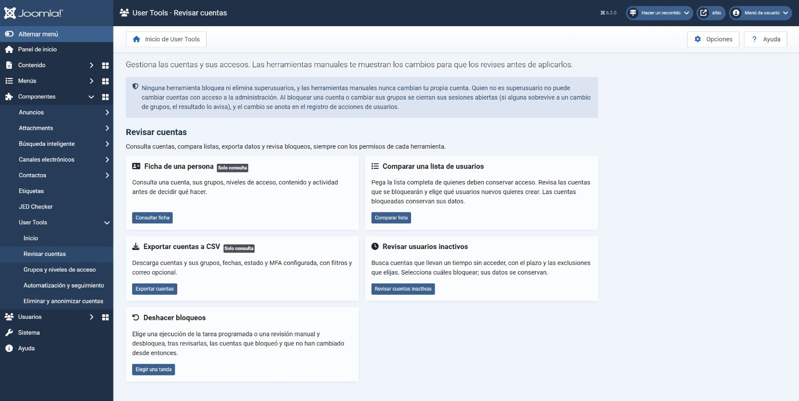
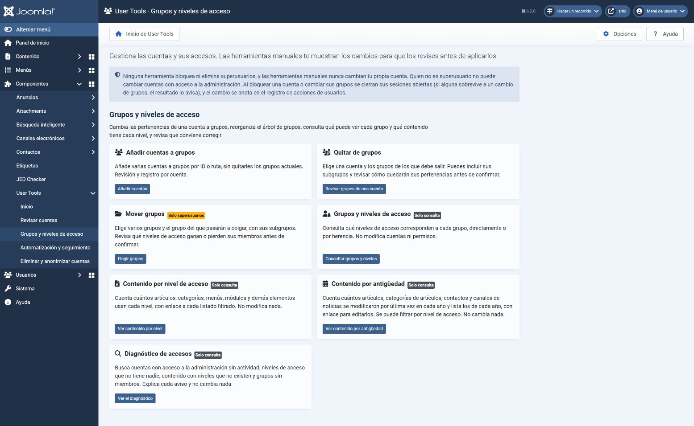
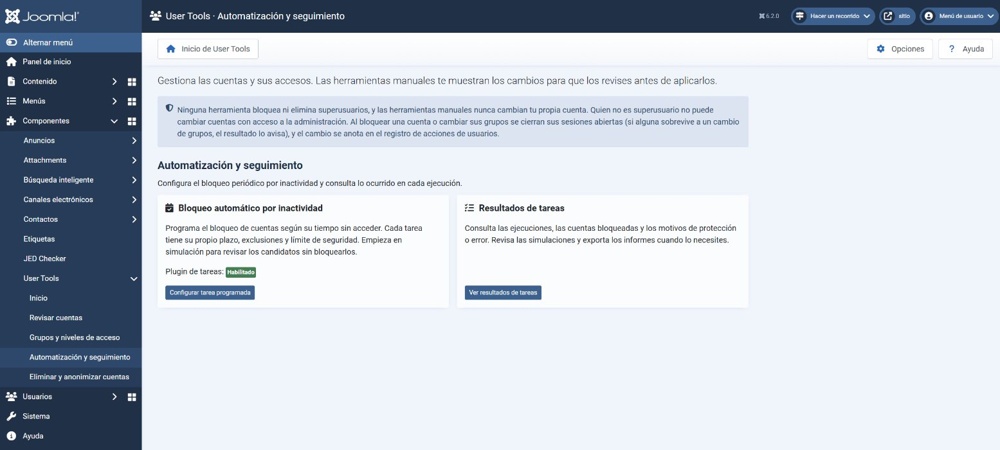
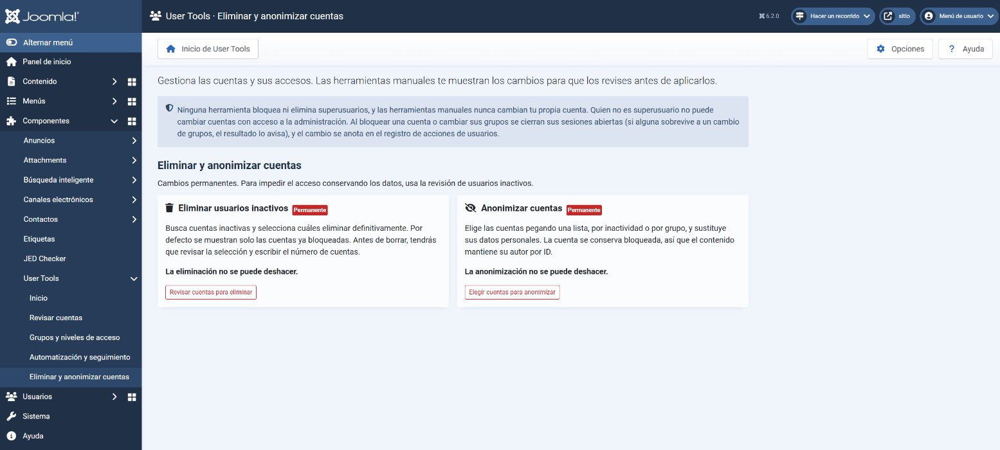

# Capturas de Joomla User Tools

**Español** · [English](screenshots.en.md)

[Volver al README](../README.md)

Estas capturas compartidas muestran la interfaz en español en Joomla 6.2.0. Cada pie indica la versión en que se hizo la captura cuando es reciente: las de eliminación son de 2026.10.5, las de quitar de grupos de 2026.10.9 y 2026.10.16, la revisión de la comparación y la de grupos y niveles de acceso de 2026.10.11, la de contenido por nivel de acceso de 2026.10.12, las de diagnóstico de accesos y la lista de contenido por antigüedad de 2026.10.15, las de mover grupos de 2026.10.16, las de añadir cuentas a grupos, exportar cuentas y deshacer bloqueos de 2026.10.19, las de la ficha de una persona de 2026.10.20, y la portada, las categorías del menú, el panel de Usuarios, la tabla de contenido por antigüedad con sus cuatro tipos y el recorrido guiado, de 2026.10.21. Las que no indican versión corresponden a una interfaz anterior y pueden diferir de la actual. Para las opciones y el comportamiento vigentes, consulta el [README](../README.md) y las [preguntas frecuentes](../FAQ.md).

Además de estas capturas, la CI comprueba el orden de teclado, el despliegue del menú y la categoría activa, y guarda capturas a texto al 200 %, con preferencia oscura y a 390 px de ancho. Las tarjetas caben a 390 px, pero la cabecera general de Joomla genera un ancho de documento de 600 px; no se ha alterado la plantilla para ocultarlo. Esto no acredita conformidad WCAG ni sustituye pruebas con lector de pantalla.

